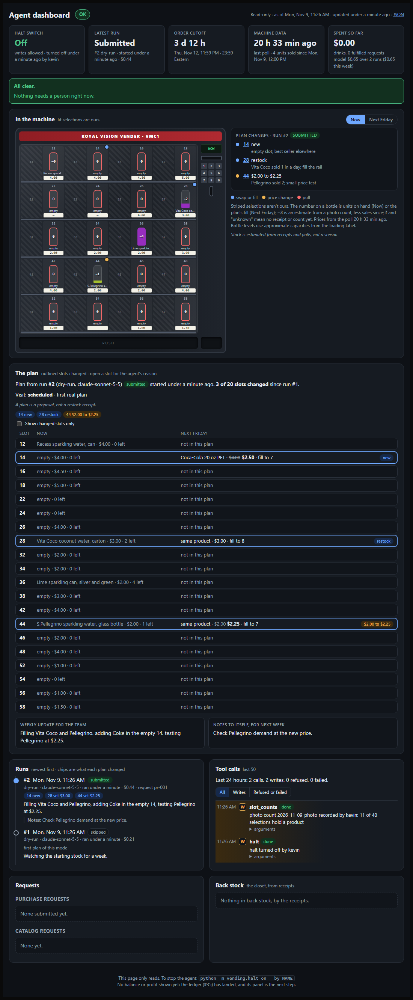

# The agent dashboard

A read-only web page for watching the agent while it runs: is it halted, what is it doing, what
did it plan, and what changed since last week.

```
python -m vending.dashboard              # then open http://127.0.0.1:8765
python -m vending.dashboard --port 9000
```

It reads whatever database `DATABASE_URL` points at: your local one, or the team's Azure
database. The page refreshes every 30 seconds. `/state.json` returns the same data as JSON, for a
script or another agent.



*Sample data from a throwaway database, not a real run. **The highlighted columns in this picture are not our real slots.** For the screenshot our slots were set to columns 2, 4, 6 and 8, to show the page follows `vending.slots`. Our real slots are the ones `vending/slots.py` lists.*

## What it shows

The page answers four questions, top to bottom: is it OK, what is it doing, what did it plan, and
what changed and why.

| Part | What's in it | Where it comes from |
|---|---|---|
| Verdict | **OK**, **Check** or **Problem** next to the title (and in the browser tab), from the worst item in Needs attention | everything below |
| Tiles | The halt switch and who last changed it; the latest run and how long it has run; a countdown to the Thursday 23:59 Eastern cutoff; how old the last machine poll is and units sold since; what has been spent on drinks (fulfilled requests) and on the model (run costs) | `config`, `agent_runs`, `polls`, `purchase_requests` |
| Needs attention | One sentence per thing a person should look at, worst first. **Problem:** the latest run failed, or has said `running` for over 2 hours. **Check:** refused or failed tool calls in the last 24 hours; polls over 3 hours old; a catalog request stuck in `sending` or `unknown`; the latest purchase request rejected; and within 24 hours of the cutoff, still halted or no Friday request sent. **Info** (doesn't change the verdict): halted, no polls yet, stock warnings from the receipts, a panel whose table is missing | the snapshot |
| In the machine | The machine's face, upright: 5 shelves of 8 selections (row r, column c is selection "rc"), with our selections lit and the rest striped. Which selections are ours comes only from `vending.slots.SLOTS`. Each of ours shows its number, a bottle filled to the units on hand with the count on it, the product under it and the price tag. **Now** is the tag price from the latest poll and the product and units on hand from the receipts, or from a person's count where the receipts don't know the slot or the count is newer (see below). **Next Friday** is the latest plan: its product, price (the tag now struck through when it changes) and fill; slots the plan changed are outlined, with a dot for the kind (blue swap or fill, amber price, red pull). Beside it, each change with the agent's reason. Click a selection to open it in the plan | `vending.stock` (receipts and polls), `get_machine_state` (polls), `agent_runs` |
| The plan | "N of 20 slots changed since run #X", a chip per change that jumps to the slot and opens its reason, a "Show changed slots only" switch, then one line per slot (product, price, fill, change tags) that opens to the reason, what it was, and what the slot holds and sold this week. Under it, the weekly update for the team and the notes to itself | `agent_runs`, `vending.stock`, `get_machine_state` |
| Runs | The last 10 runs as a timeline: mode, model, how long, cost, request, how it ended, and chips for every slot its plan changed from the plan before it. Under each, **How it decided** opens the run's steps in order: the model's reasoning (a summary the API returns, never the raw chain of thought), anything it wrote, each tool call and what came back, with failed replies in red. A run in progress shows the steps so far | `agent_runs`, `agent_steps` |
| Tool calls | Counts for the last 24 hours, then the last 50 calls. Writes are marked W and shaded; refused and failed calls are red. Filter to writes or to refused and failed; each call's arguments open on a click | `action_log` |
| Requests | Our last 10 purchase requests (status, what was paid, lines loaded, unavailable and alternates) and catalog requests | `purchase_requests`, `purchase_lines`, `product_requests` |
| Back stock | What the receipts say is in the closet, and what each unit cost us | `vending.stock` |

A bottle's level is the units over the package's capacity from the machine's loading label
(`PACKAGE_CAPACITY`: 20 oz PET 7, 16 oz glass 7, 16 oz PET 8, 12 oz can 8, 240/250 ml can 11,
14 oz PET 8; approximate), used only when the product name states the package. Otherwise it is
drawn against the plan's fill, or the count itself. Bottle colours come from a hash of the product
name, so there is no brand table to keep up.

A slot counts as changed when what the plan asks for changes (product, fill, price, keep). A
reworded reason alone is not a change. Status and the machine follow `live` and `dry-run` runs
only, and a plan is compared only with the last plan of the same mode; replays of past weeks show
under Runs, dimmed. Model spend counts `live` and `dry-run` runs.

The page refreshes itself in place every 30 seconds, keeping your scroll position, any open
slot or arguments, the tool-call filter, the Now / Next Friday choice and the changed-only switch,
and the verdict in the tab title. Without JavaScript the machine shows Now, the plan shows every
slot, and the switches are hidden. If a refresh fails (the database is down) it keeps the last
page and says how old it is. Without JavaScript it reloads the whole page instead.

## Honesty rules

The page shows only what something recorded, and says so when nothing did.

- **Stock is estimated from receipts and polls, not a sensor.** Units on hand are what the
  fulfilled receipts loaded, minus what the polls' counters say sold, minus recorded losses.
- **A plan is a proposal, not a restock receipt.** Next Friday is what the agent asked for, not
  what a worker loaded.
- **Unknown stays unknown.** A selection with no receipt shows `?` and "unknown", never a guess
  from the plan. A price with no poll shows a dash. Without a plan, Next Friday says "No plan yet".
- **No balance or profit shown yet: the ledger (#35) has landed, and its panel is the next step.**

**Not shown yet:** the balance and profit and loss. They arrive with the ledger (#35); a tile is a
small addition once it merges. "Spent so far" is only what the receipts and run costs record.

## What is in the machine: counts

The polls never say which product is in a selection, and receipts only name what we stocked
ourselves. So a person records what they see, and the dashboard takes it from there:

```
python -m vending.slot_counts record db/counts/2026-11-09-photo.json --by kevin --dry-run   # check it
python -m vending.slot_counts record db/counts/2026-11-09-photo.json --by kevin             # record it
python -m vending.slot_counts show
```

A count file lists every selection looked at, ours or not: the product as seen (or null when
empty), the units on the rail and the price on the tag. `source` is `photo` (an estimate: a
picture can't see how deep a rail goes) or `door` (counted with the door open, exact). Recording
writes the whole count in one transaction and logs it to `action_log`; a count id can be recorded
once, and the command never migrates. It isn't gated by the halt switch, because a count changes
nothing in the machine.

On the page, a counted slot shows units counted less what sold since, from the polls: sales
start at the first poll after the count, so nothing sold before it is taken off twice. A photo
count shows as "~3"; a slot the count saw empty shows "0 · empty". A restock receipt newer than
the count replaces it. `db/counts/2026-11-09-photo.json` is the first count, read from photos of
the machine on 9 Nov; its units are estimates and brands that couldn't be read are kept as the
visible description.

## Safety

- **It can't write.** Its connection sets `default_transaction_read_only`, so Postgres refuses
  any write, and it never migrates. A table that doesn't exist yet blanks only its own panel.
- **It listens on 127.0.0.1 only, and has no login.** It answers only requests addressed to
  `127.0.0.1` or `localhost`, so another website can't point its own name at your machine and
  read the page. To watch the Azure container from a laptop, use an SSH tunnel or run it locally
  against the Azure database; don't expose it.
- **It costs nothing to run.** No model calls, no new services, no new packages.

## The run record

The plan, update and notes come from `agent_runs` (`db/migrations/009_agent_runs.sql`). Nothing
writes it yet: the agent loop (#39) should call `vending.agent_runs` at the start and end of each
run, and the agent replay can do the same with `mode="replay"`:

```python
from vending import agent_runs

run_id = agent_runs.start(conn, mode="dry-run", model="claude-sonnet-5-5")
# ... the run ...
agent_runs.finish(conn, run_id, "submitted", plan=plan, update=update, notes=notes,
                  cost_usd=Decimal("0.42"), request_id=request_id)
```

`status` is one of `submitted`, `skipped`, `halted` or `failed`. `plan` is the replayer's decider
shape (`docs/week-replayer.md` on #28). `cost_usd` must be a `Decimal`, and a `Decimal` price in the plan is stored as exact text
(`"2.50"`). A run finishes once; a second `finish` raises.

Times on the page show in your browser's time zone. On Windows, the cutoff date needs the
`tzdata` package (`pip install tzdata`); without it the page says "Thursday 23:59 Eastern".

## Where it could go next

Ideas for the team to react to. None of this is built.

**A. Headline numbers and stock.** Tiles for the halt switch, the cutoff countdown, the balance
and the week's profit, and a stock bar in each slot. The tiles need the ledger (#35) and token
spend (#40); the stock bars can use `vending.stock` today.

**B. Plan history.** One card per week: the update, the slots that changed, the notes, what it
cost. Everything it needs is in `agent_runs` once #39 writes it.

**C. A live run.** Each tool call as it happens, the draft plans as they change, and the run's
budget. Each run's steps, its reasoning included, are now in `agent_steps` and show under
How it decided, so what is left is a page that follows one run live and the run's budget.
