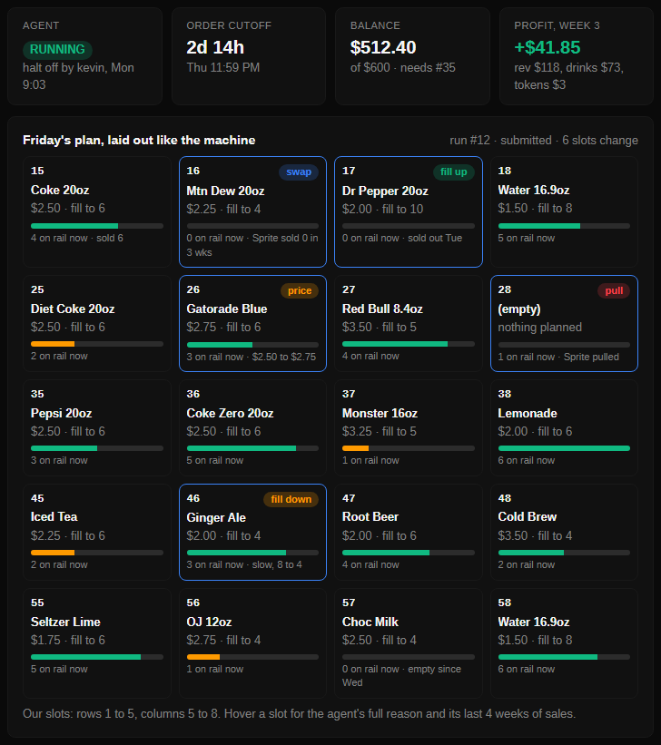
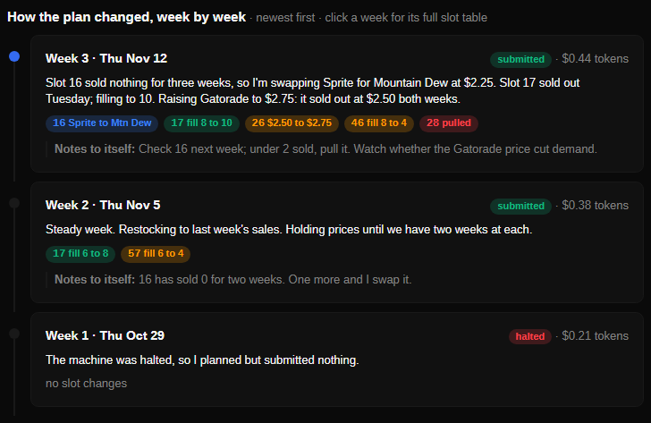
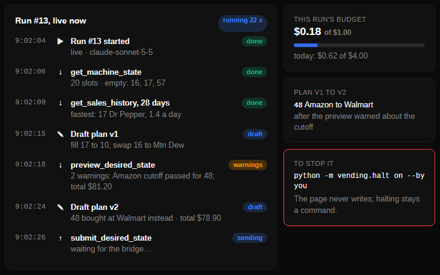

# The agent dashboard

A read-only web page for watching the agent while it runs: is it halted, what is it doing, what
did it plan, and what changed since last week.

```
python -m vending.dashboard              # then open http://127.0.0.1:8765
python -m vending.dashboard --port 9000
```

It reads whatever database `DATABASE_URL` points at: your local one, or the team's Azure
database. The page refreshes every 30 seconds. `/state.json` returns the same data as JSON, for a
script or another agent.


*Sample data from a throwaway database, not a real run.*

## What it shows

| Panel | What's in it | Where it comes from |
|---|---|---|
| Status | The halt switch and who last changed it, the latest run, the last tool call, and the next Thursday 23:59 Eastern cutoff | `config`, `agent_runs`, `action_log` |
| Plan | The latest run's plan for every slot, laid out like the machine (rows 1 to 5, columns 5 to 8). Slots that changed since the last plan are outlined and tagged (swap, price, fill 6 to 8, pull) and say what they were. Above it, the agent's weekly update for the team and its notes to itself | `agent_runs` |
| Runs | The last 10 runs: mode, model, how each ended, what it cost, the request it sent | `agent_runs` |
| Activity | The last 50 tool calls, reads and writes. Writes are shaded; refused and failed calls stand out | `action_log` |
| Requests | Our last 10 purchase requests and catalog requests, and where each stands | `purchase_requests`, `product_requests` |

A slot counts as changed when what the plan asks for changes (product, fill, price, keep). A
reworded reason alone is not a change. A run still marked `running` two hours after it started
is shown as probably dead. Status and Plan follow `live` and `dry-run` runs only, and a plan is
compared only with the last plan of the same mode; replays of past weeks show under Runs.

**Not shown yet:** the balance and profit and loss. They arrive with the ledger (#35); the panel
is a small addition once it merges.

## Safety

- **It can't write.** Its connection sets `default_transaction_read_only`, so Postgres refuses
  any write, and it never migrates. A table that doesn't exist yet blanks only its own panel.
- **It listens on 127.0.0.1 only, and has no login.** It answers only requests addressed to
  `127.0.0.1` or `localhost`, so another website can't point its own name at your machine and
  read the page. To watch the Azure container from a laptop, use an SSH tunnel or run it locally
  against the Azure database; don't expose it.
- **It costs nothing to run.** No model calls, no new services, no new packages.

## The run record

The plan, update and notes come from `agent_runs` (`db/migrations/009_agent_runs.sql`). Nothing
writes it yet: the agent loop (#39) should call `vending.agent_runs` at the start and end of each
run, and the agent replay can do the same with `mode="replay"`:

```python
from vending import agent_runs

run_id = agent_runs.start(conn, mode="dry-run", model="claude-sonnet-5-5")
# ... the run ...
agent_runs.finish(conn, run_id, "submitted", plan=plan, update=update, notes=notes,
                  cost_usd=Decimal("0.42"), request_id=request_id)
```

`status` is one of `submitted`, `skipped`, `halted` or `failed`. `plan` is the replayer's decider
shape (`docs/week-replayer.md` on #28). `cost_usd` must be a `Decimal`, and a `Decimal` price in the plan is stored as exact text
(`"2.50"`). A run finishes once; a second `finish` raises.

Times on the page show in your browser's time zone. On Windows, the cutoff date needs the
`tzdata` package (`pip install tzdata`); without it the page says "Thursday 23:59 Eastern".

## Where it could go next

Mockups with made-up numbers, for the team to react to. None of this is built.

**A. Headline numbers and stock.** Tiles for the halt switch, the cutoff countdown, the balance
and the week's profit, and a stock bar in each slot. The tiles need the ledger (#35) and token
spend (#40); the stock bars can use `vending.stock` today.



**B. Plan history.** One card per week: the update, the slots that changed, the notes, what it
cost. Everything it needs is in `agent_runs` once #39 writes it.



**C. A live run.** Each tool call as it happens, the draft plans as they change, and the run's
budget. The tool calls are already in `action_log`, and every `preview_desired_state` call logs
the draft plan it checked, so "plan v1 to v2" can be read from it. It needs a run id on
`action_log` rows to group them, and the budget needs #40. The model's reasoning between calls
isn't recorded anywhere yet.


