# The agent dashboard

A read-only web page for watching the agent while it runs: is it halted, what is it doing, what
did it plan, and what changed since last week.

```
python -m vending.dashboard              # then open http://127.0.0.1:8765
python -m vending.dashboard --port 9000
```

It reads whatever database `DATABASE_URL` points at: your local one, or the team's Azure
database. The page refreshes every 30 seconds. `/state.json` returns the same data as JSON, for a
script or another agent.

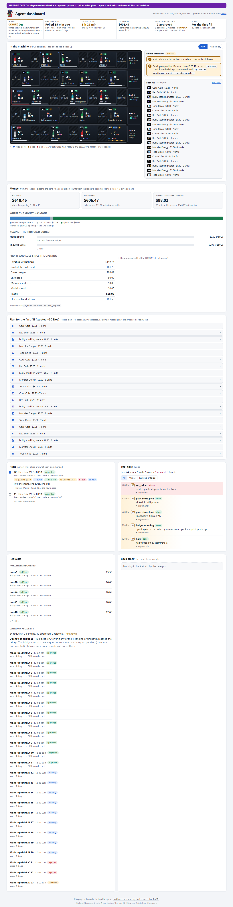

*Made-up data from a throwaway database, not a real run, and the purple banner says so. **The selections lit in this picture are not our real slots.** For the screenshot the stored assignment was set to 20 scattered selections, to show the page follows `vending.slots`. Our real slots are the ones the stored server assignment names (`python -m vending.slots`).*

The money panel (#48), with seeded test data rendered at a fixed time (9 Dec): an opening of $600, two fulfilled
requests, three model calls and one pending request. Light, dark and phone:

| Light | Dark | Phone |
|---|---|---|
| 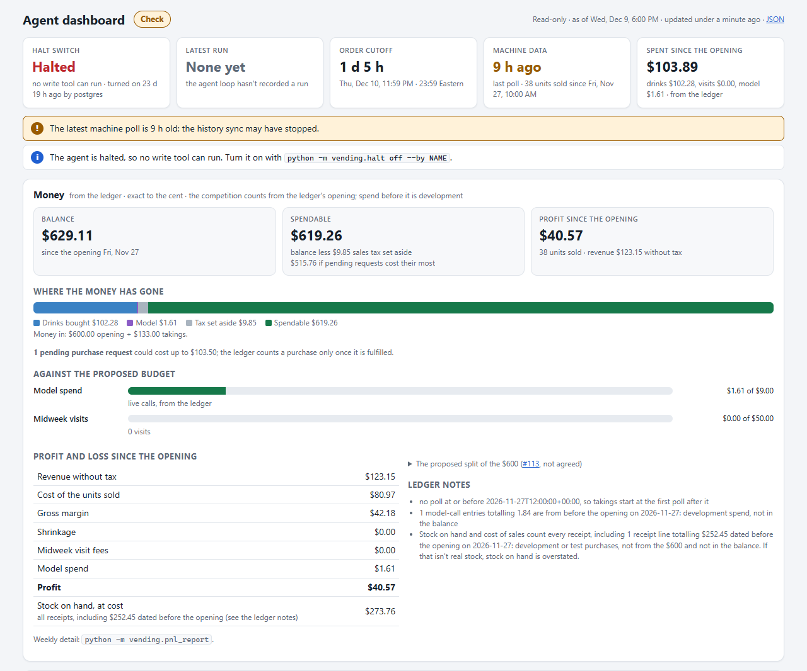 | 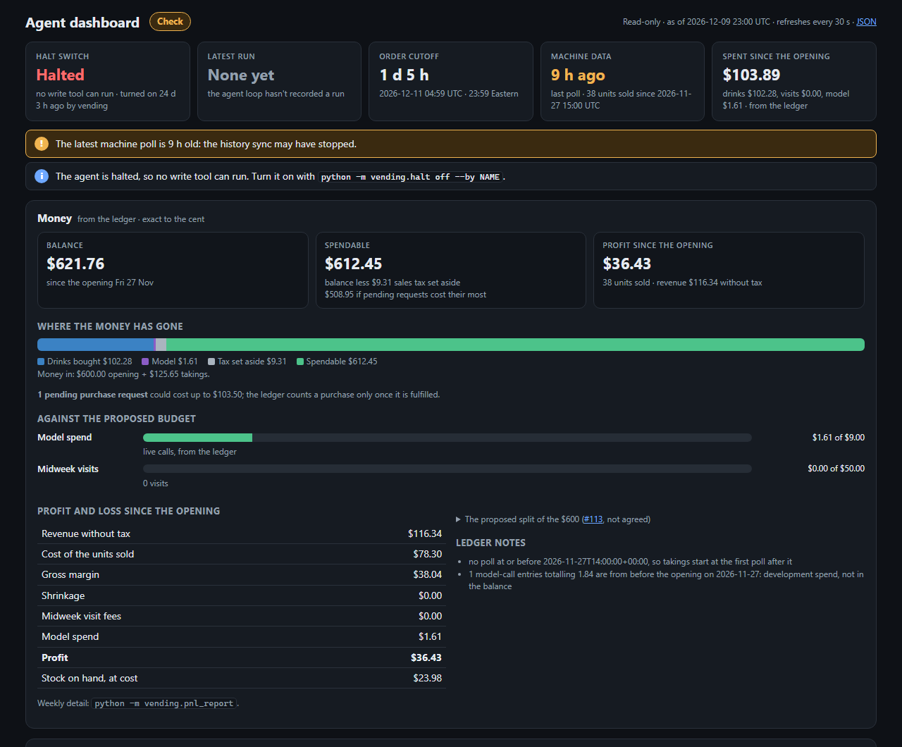 | 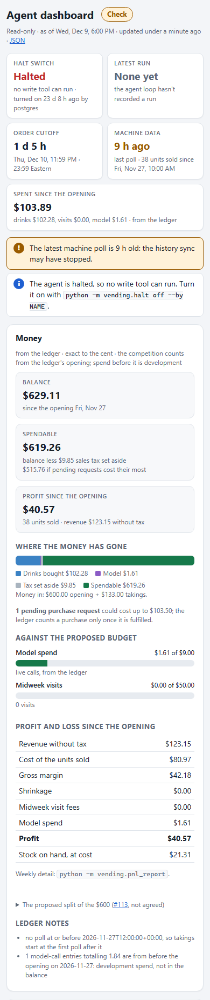 |

## What it shows

The page answers four questions, top to bottom: is it OK, what is it doing, what did it plan, and
what changed and why.

| Part | What's in it | Where it comes from |
|---|---|---|
| Status bar | One row of six cells, each a link to its section. **Agent:** the verdict (**OK**, **Check** or **Problem**, from the worst item in Needs attention; the browser tab shows it too), the halt switch and who last changed it, and the latest run. **Machine poll:** how long ago the last poll was taken, its time in Eastern, when the worker's next sync should read the machine (the worker's own `next_round_at` when it serves the page, else `SYNC_AT_MINUTE` past the hour), and what our slots sold in the 7 days to that poll. The window's start date isn't shown: it read like an update time. **Order cutoff:** a countdown to Thursday 23:59 Eastern. **Spendable:** from the ledger once its opening entry is in the past, with what has been spent since the opening; if the ledger can't give a balance (no slot assignment, say), "Balance unavailable" and the spend since the opening. Before the opening it shows no test runs or test purchases, only that this is development spend, not from the \$600. Where the server serves the charts, the cell links the development-spend chart. **Catalog approvals:** approved, pending, rejected, any `sending` or `unknown`, the places left under the bridge's cap, and the 25 Nov deadline until it passes. **Plan:** before the slot lock, the plan for the first fill (its slots and its most-we-pay cost against the proposed \$366 cap); from the lock, the plan for the next restock: "For the next restock · Fri 4 Dec · 2 changes", or "midweek visit" for a paid off-cycle visit, which the plan records without a date. Almost every restock is the free Friday visit, the Friday after the Thursday cutoff that follows the plan's run; a paid \$25 midweek visit is a restock too, and either can change anything. On a phone the six cells wrap to two columns | `config`, `agent_runs`, `polls`, `purchase_requests`, `vending.ledger`, `product_requests`, `first_fill_plans` |
| In the machine | One screen. On the left, the machine's whole front: 5 shelves of 8 (row r, column c is selection "rc"). Which selections are ours comes only from the stored assignment (`vending.slots.our_slots`, kept by `python -m vending.slots record`), read on every page; with none stored the section says so and draws nothing. Each of ours shows its number, a next-restock badge (+N back, swap, new, \$ for a new price, pull), its front package, units against capacity, the tag price, the product name and a fill bar. Every other selection is a grey cell half as wide with its number and "Not ours", and nothing else about it is in the page or `/state.json`. Beside each shelf, what our lanes on it hold and what the next restock adds. On the right, **Needs attention** and the plan's changes (before the lock, each line of the plan for the first fill; after it, each slot the latest plan changed, with the agent's reason). Tap one of ours on the front, a row of the plan's changes, or a slot number in The plan, and the right side shows that selection's shelf from above instead, with the picked lane wider and not-ours lanes half width, and its facts: on hand, price, what the slot sold, the next restock, the plan's fill check ("fills 6 of 8: 2 spaces empty", as on The plan's rows and the side card's), the first fill, capacity and the agent's whole reason, each saying where it comes from ("from receipts and polls", "unknown: no price from the polls"). **Close** (or Escape) goes back to Needs attention. The wildcard slot (config `wildcard_slot`, #166) is marked only when the stored assignment makes it ours: a **W** badge on the front, a "wildcard" chip on its lane, a Wildcard line in its facts, and a pill on its rows in the plan's changes and The plan. **Now** is the tag price from the latest poll and the product and units on hand from the receipts, or from a person's count where the receipts don't know the slot or the count is newer (see below). **Next restock** is the latest plan (the toggle's hint gives its date: "Next restock · Fri 4 Dec", or "midweek visit"): the empty slots fill in, a swap draws the new product's package and colours, a pull empties the lane, and a new price shows the old one struck through | `vending.stock` (receipts and polls), `get_machine_state` (polls), `agent_runs`, `first_fill_plans`, `catalog_products`, `config.capacity_overrides` |
| Pricing | One row per selection of ours (the stored assignment, nothing else). **Now** is the shelf price from the latest poll. **Unit cost** is what the units in the slot cost, from the receipts; with no receipt cost it is the primary sourcing option's pack price over the pack size, labelled **expected** (the product is the receipts', else the plan's). **Floor** is the pricing gate's, as the planner sets it for a restock: the highest of the receipt cost's floor and each sourcing option's floor at its most-we-pay price (`pricing.floor_cents`, `pack_floor_cents`); hover it for the parts. **Legal** is `pricing.check_price` against that floor and the selection's ceiling, the planner's (`planner.Config.ceiling_for`: \$6.50, or \$8.00 for the one wildcard selection, #166); with no cost known the floor is unknown, and only the 5-cent step and the ceiling are checked. A price that isn't legal shades the row and says why. **Margin** is what one sale keeps after the sales tax inside the price, less the unit cost. **Sold** is units in the last 7 days and per class day (own rate, or the fall prior until the slot has 5 in-stock class days). **Plan** follows the plan that "The plan" shows: before the slot lock, the first-fill plan's price (marked **first fill**); from the lock, the agent's weekly plan. It shows the new price and the reason, checked the same way against the floor of the product that plan puts in (its sourcing rows, else the first-fill plan's own floor). A plan entry of an unexpected shape gives that row no plan price. The line is the shelf price at every poll over the last 28 days, a dot at each change; a change shows at the poll that first saw it | polls (`get_machine_state`, `machine_state.price_history`), `vending.stock`, `sourcing_options`, `config`, `agent_runs` |
| Needs attention | Beside the machine, never cut short. One sentence per thing a person should look at, worst first. **Problem:** the latest run failed, or has said `running` for over 2 hours; on the Container App, a job in the worker's latest hourly sync didn't exit 0 (see [Sync health](#sync-health)). **Check:** refused or failed tool calls in the last 24 hours; polls over 3 hours old; a catalog request stuck in `sending` or `unknown`; the latest purchase request rejected; and within 24 hours of the cutoff, still halted or no Friday request sent. **Info** (doesn't change the verdict): halted, no polls yet, stock warnings from the receipts, a panel whose table is missing | the snapshot, and the worker's latest sync |
| The plan | Before the slot lock, the plan for the first fill. Each line shows the product, price and units. Open it for the agent's reason and the code's checks. The header compares the fill cost with the proposed $366 cap. The page shows the picked plan or labels the latest one "latest, not picked". A plan for an earlier assignment shows a message with no slots. From the lock, the agent's plan for the next restock shows its slot changes, reasons, weekly update and notes; each line also says what the slot sold in the 7 days to the last poll. That count is the slot's, not the product's: a swap at a visit inside the window adds the old product's sales (#172), and the page says so. | `first_fill_plans` before the lock, then `agent_runs`, `vending.stock` and `get_machine_state` |
| Runs | The last 10 runs as a timeline: mode, model, how long, cost, request, how it ended, and chips for every slot its plan changed from the plan before it. Under each, **How it decided** opens the run's steps in order: the model's reasoning (a summary the API returns, never the raw chain of thought), anything it wrote, each tool call and what came back, with failed replies in red. A run in progress shows the steps so far | `agent_runs`, `agent_steps` |
| Tool calls | Counts for the last 24 hours, then the last 50 calls. Writes are marked W and shaded; refused and failed calls are red. Filter to writes or to refused and failed; each call's arguments open on a click | `action_log` |
| Money | **Balance**, **spendable** (balance less the sales tax set aside) and **profit since the opening**. One bar shows where the money in (opening, capital, takings) has gone: drinks bought, midweek visits, model spend, tax handed over, tax set aside, and what is still spendable. Then model spend against the proposed \$9 and visit fees against the proposed \$50, the profit and loss since the opening (units sold across a swap the counters can't split have no exact cost, so cost of sales and profit show as unknown, and their estimate gets its own line, labelled as an estimate and not in profit, #172), the proposed split of the \$600 (#113), and the ledger's notes about the live period. **Committed:** what the pending purchase requests could still cost at most (the dearer of each line's primary and alternate at `packs x max_price_per_pack`, plus an off-cycle request's visit fee), since the ledger counts a purchase only once it is fulfilled. If any pending line has no price we can read, the most is unknown, never counted as \$0, and so is what stays spendable after it. The ledger figures count spending from the opening entry. Before the opening entry, it says how to record it; an opening entry dated in the future (recorded ahead with `--at`) keeps that view and says when the ledger opens. Receipts and visit fees from before the opening are test purchases: once the opening is recorded, stock on hand and cost of sales leave them out too (`stock.receipts_count_from`, #150). A submission sent with no usable answer (`sending` or `unknown` in `purchase_submissions`) counts as committed too, since it may exist at the bridge. Needs attention adds: **Problem** if spendable is below zero, or if pending requests could cost more than is spendable; **Check** if spendable would fall under the proposed \$53 floor, if requests are pending with no opening entry or before an opening dated ahead (the date in Eastern), if a submission is unsettled, if a pending line has no price we can read, or if the ledger can't give a balance (for example, our slot assignment isn't recorded); **Info** if model spend passes \$9. If reading the ledger passes the statement timeout, only this panel says it isn't available; the rest of the page still shows | `vending.ledger` (`balance`, `pnl`), `purchase_requests`, `purchase_submissions` |
| Requests | Our last 10 purchase requests (status, what was paid, lines loaded, unavailable and alternates). Then every catalog request, newest first: counts by status, the open (`pending`) ones against the bridge's cap and the places left, and each request's status, its SKU once it has one (an approved product may be added under a SKU we wouldn't guess), and the decision note | `purchase_requests`, `purchase_lines`, `product_requests` |
| Back stock | What the receipts say is in the closet, and what each unit cost us. Links to the [Products page](#the-products-page) | `vending.stock` |
| Product leaderboards | The ten best sellers by SKU, flavor, and brand for our current assignment. Each row shows units sold, revenue excluding tax, and sell-through. Sell-through divides units sold by units loaded since the opening. For this week (Saturday to Friday, Eastern), it divides units sold by starting stock plus units loaded. The rate is unavailable if sales exceed recorded stock. Sales with an unknown product stay out of the rankings. The panel counts those sales and labels the units with an estimated cost. | `vending.stock`, `vending.ledger`, `catalog_products` |
| Footer | One small line on who has looked: browsers, visits and sign-ins, all time and this week (`vending.visits`; see [`deploy.md`](deploy.md#the-public-pages)) | `page_visits`, `page_visit_totals` |

### The machine close-up

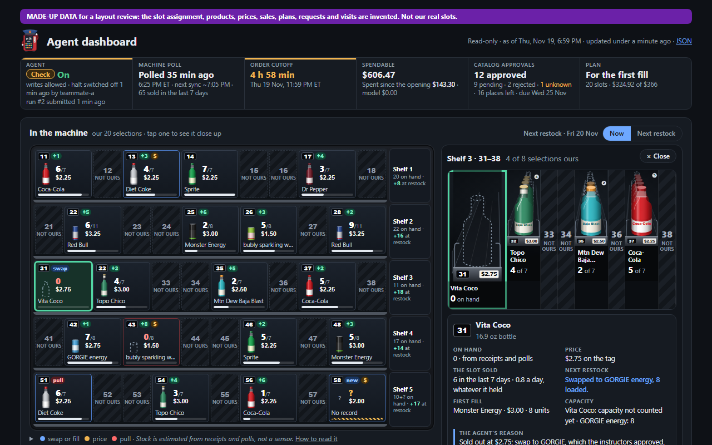

| | |
|---|---|
| 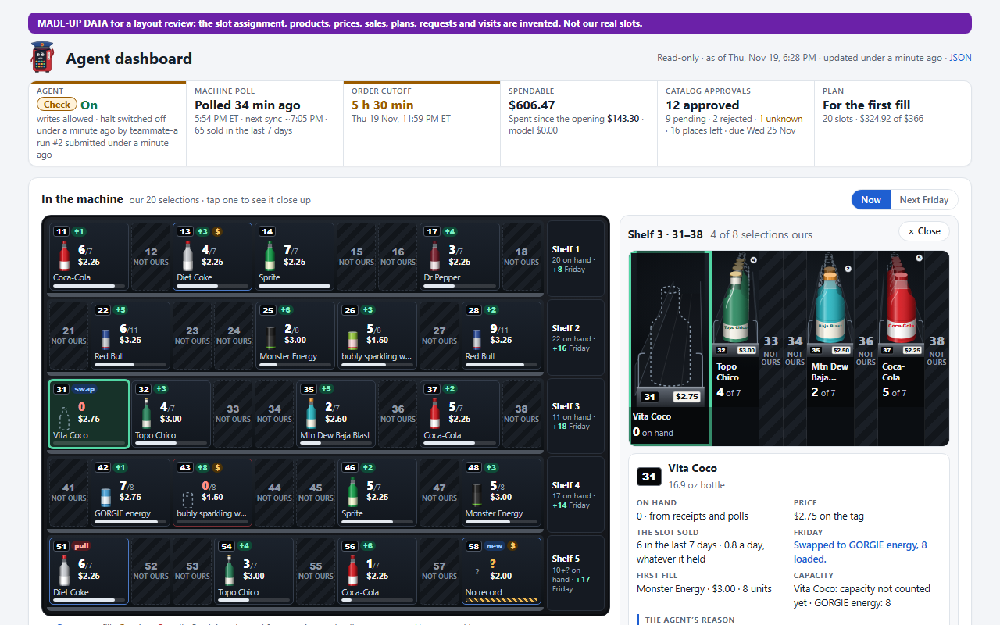 | 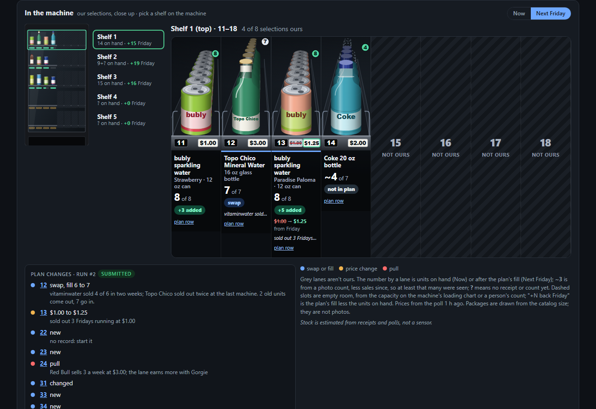 |
| Light theme, before the slot lock: 32, the made-up wildcard, picked | After the lock, Next restock: a swap (31), new prices (13, 43, 58), a pull (51) |

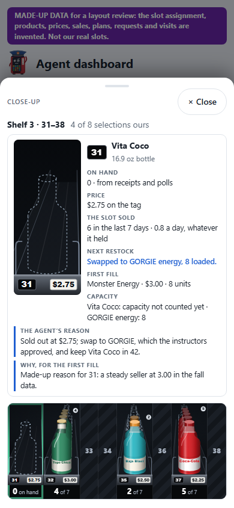

*Made-up data in a throwaway local database, not a real run, and the purple banner says so: the
slot assignment (20 scattered selections), products, prices, sales, plans, reasons, requests and
visits are invented. Seeded 19 Nov 2026.*

How to read a lane:

- **Count.** The big number is units on hand (Now) or after the plan's fill (Next restock). **~4**
  is from a photo count: units seen down the rail, less sales since, so at least that many. **?**
  means no receipt or count yet; the rail behind the front item is then hatched, never drawn full or
  empty.
- **+N at restock** is the plan's `fill_to` less the units on hand, when both are known. With
  units unknown it is **+?**. With no plan there is no number, only "no plan yet". It is never
  capacity less units.
- **Dashed slots** are empty room in the column, based on [package capacity](capacity.md).
  When capacity is unknown, the lane draws only the planned fill and says "capacity not counted yet".
- **Fill check.** The current plan shows how many spaces a proposed fill leaves and the reason,
  if given. The same warning appears under Needs attention as a Check. A plan line with unknown
  capacity says "capacity not counted".
- **Swap, pull, price.** On Next restock a swap draws the new product, a pull shows the lane empty,
  and a price change strikes the old tag through. The agent's reason is cut to one line; the full
  text is in the plan row.
- **Named from a count.** Photo and door counts name a product in free text, not a SKU, so it
  can't be looked up in the catalog. The package is then read from the name ("Coke 20 oz bottle"),
  with a hash colour, and the lane says "named from a photo count".

Where the drawing comes from (`vending/machine_art.py`; no photos, no images, no model calls):

- **Package shape**: `SHAPES`, one entry per package with real millimetre sizes (typical retail
  figures, not measured on our packages), picked by the catalog `size` through
  `capacity.parse_size`, the same reading the capacity chart uses. A size it can't read gets the
  generic bottle, can or carton (`FALLBACK`).
- **Colours and label**: `LOOKS`, by SKU, then `line|flavor`, then line, all lower case. Anything
  else gets a steady colour from a hash of the SKU and the first word of its line as its label, so
  a product added to the catalog today draws without any change here.
- **The one extra read**: the snapshot's `products` entry reads `catalog_products` (sku, name,
  line, flavor, size) for the products our lanes hold now or next, and the capacity overrides for
  them, in the same read-only, repeatable-read snapshot. If that read fails, the page still draws:
  packages are guessed from names, capacities are unknown, and the legend says so.

To make a product look right, add a row to `LOOKS` in `vending/machine_art.py`, keyed by its line
and flavor as the catalog spells them, lower case (`"bubly|strawberry"`), or by its line alone for
every flavor:

```python
"bubly|strawberry": {"c1": "#94c93a", "c2": "#f6d3d6", "c3": "#e23b4f", "ink": "#8a1a2a", "label": "bubly"},
```

`c1` is the body, `c2` the label band, `c3` the cap or stripe, `ink` the label text, and `label` a
word or two printed on the front package. A new package size (a 1 L bottle, say) is a new `SHAPES`
entry with its diameter and height; anything else in the page needs no change.

On a phone the front comes first, then Needs attention and the plan's changes. Tapping one of ours
opens its close-up as a sheet from the bottom: the picked lane large beside its facts, with the
whole shelf under it. Close it with the button, a tap outside it, or Escape. Every selection on the
front has an aria label that reads it out (product, count, next restock, price, reason); with
reduced motion set, the restock fill and the sheet don't animate.

A slot counts as changed when what the plan asks for changes (product, fill, price, keep). A
reworded reason alone is not a change. The status and machine panels follow live runs.
The plan compares with the previous live plan.

The page refreshes itself in place every 30 seconds, keeping your scroll position, any open
slot or arguments, the tool-call filter, the Now / Next restock choice, the selection you picked and
the changed-only switch, and the verdict in the tab title. A new visit starts with nothing picked,
so Needs attention shows. Without JavaScript the machine shows Now, each selection's link
(`?sel=15#sel-15`) still opens its close-up, and the timed reload keeps that pick while the stored
assignment makes it ours (Close loads the page without it, so it stays closed); a shelf's link opens its first selection of ours, so a phone's sheet opens
too. The plan shows every slot, and the switches are hidden. If a refresh fails (the database is down) it keeps the last
page and says how old it is. Without JavaScript it reloads the whole page instead.

## The demo copy

`/dashboard/demo` (with `/dashboard/demo/state.json`) is the same page drawn from made-up data, so
you can see every panel full without putting test data on the live page. It sits behind the same
password. It has a yellow banner at the top, "DEMO: made-up data, not our machine. The live page is
/dashboard", "DEMO ·" in the tab title, and `"demo": true` first in the JSON. The live header links
to it as "Demo copy"; the demo links back as "Live dashboard".

- **It never opens a database connection.** The data is a committed file,
  `vending/demo/snapshot.json`, read from disk. Nothing on the route calls `vending.slots` or any
  database reader, and it answers even where `READONLY_DATABASE_URL` isn't set.
- **It runs the live page's code.** `vending.demo` loads the file and hands it to
  `dashboard.render(..., demo=True)`. A new panel on the live page shows on the demo once the file
  is made again.
- **Its 20 selections are its own.** They are in the snapshot (`ours`), scattered over the machine,
  and are not the team's assignment. The team's stored assignment is never read.
- **It is a fixed moment.** Wed 9 Dec 2026, 10:00 Eastern, a week into the competition: $600 opened,
  a day-one fill, a midweek visit, six runs with steps, tool calls (one refused, one failed), purchase
  and catalog requests, a count, the closet. It doesn't refresh, and its times don't follow your
  clock (the live page's script does that; the demo turns it off).
- **Views of it aren't visits.** The visit counter lists `/dashboard` and `/db` only
  (`vending.visits.PAGES`), so a view of the demo is not counted at all, not even separately, and it
  hands out no browser cookie. The live page's counts stay people reading the real page. A separate
  count would need a new `page` value in `page_visits`, whose check allows `/login`, `/dashboard`
  and `/db` only (migration 016), so it is a migration; this change adds none. The counter never
  tries to write a demo view.
- **Its toggles are its own.** The page keeps the Now / Next restock choice, the changed-only
  switch and the tool-call filter in `localStorage`, which both pages share by address. The demo uses keys that start
  `demo-dash-`, the live page `dash-`, so a switch flipped on the demo doesn't move the live page's.
- **Signed out**, the demo's JSON answers 401 like the live JSON, and its page redirects to the
  password page. A POST to either is refused with 405. The demo can't set off anything that reads
  the live verdict: the JSON has no verdict of its own and says `demo`.
- **Failed calls and runs show no error text**, as on the live public page: the snapshot is made
  with `public=True`.

To make the file again (it must match the dashboard's snapshot, and a test checks that it does):

```
docker run -d --rm --label agentic-vending.scratch=true -p 127.0.0.1::5432 -e POSTGRES_PASSWORD=x postgres:17
DATABASE_URL=postgresql://postgres:x@127.0.0.1:PORT/postgres python -m vending.demo.make
```

The generator refuses a host that isn't this machine. It builds a throwaway schema, fills it with
made-up data (`vending/demo/make.py`), runs `snapshot()` on it, writes the file and drops the schema.
It writes the [Products page](#the-products-page)'s demo data (`vending/demo/products.json`) from the
same schema. `--check` says whether both committed files are current. Stop the container afterwards.

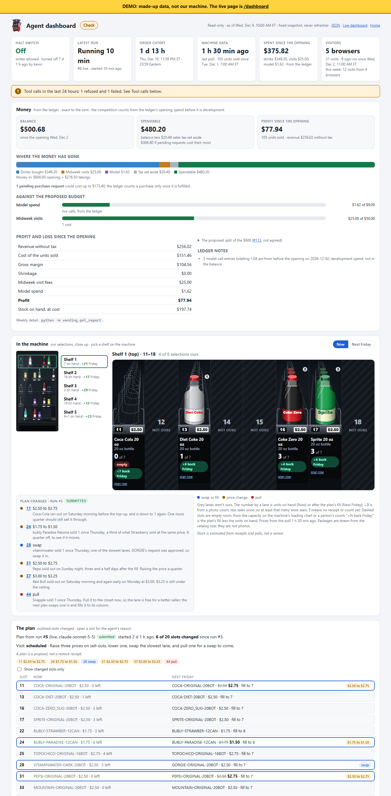

| Dark | Phone |
|---|---|
| 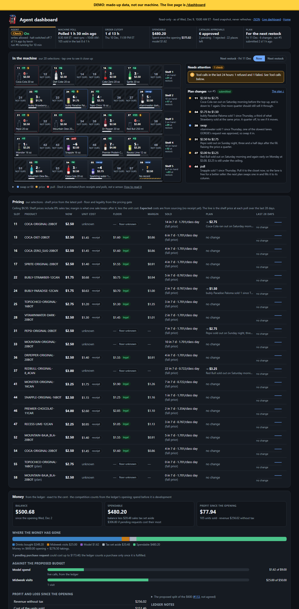 | 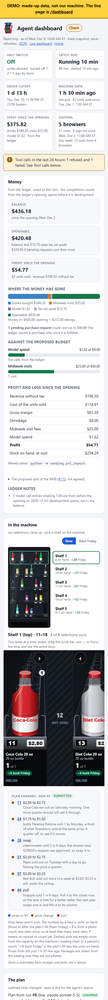 |

## The Products page

`/dashboard/products` (#55): every product we can order and what is in back stock, so nobody has to
query the tables. David asked for it on 11 Nov. It is linked as "Products" in the dashboard's header
and from Back stock. `python -m vending.dashboard` serves it too, at `/products`.

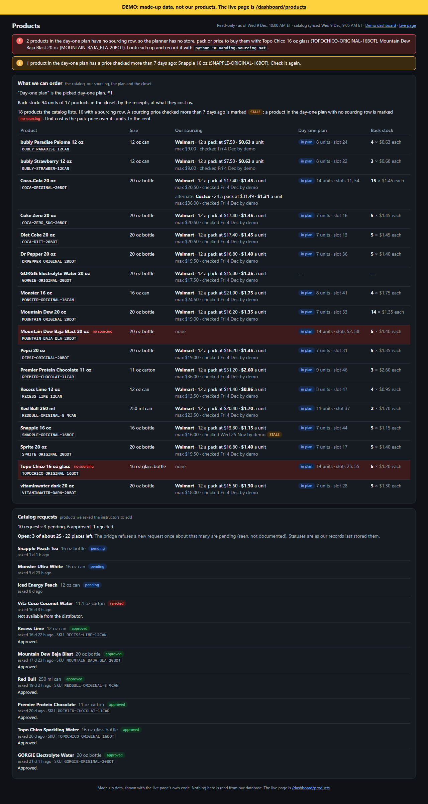

*The demo copy (`/dashboard/demo/products`): made-up products, prices, plan and closet.*

| Part | What's in it | Where it comes from |
|---|---|---|
| Warnings at the top | **The catalog's age:** never synced, or last synced more than 36 hours ago (the rule `get_catalog` uses). **Planned products with no sourcing row:** the planner has no store, pack or price for them (on 20 Nov, 8 of round 6's drinks had no checked price). A planned line with no SKU yet counts too. **Planned products with a stale price** (checked more than 7 days ago) | `catalog_syncs`, `sourcing_options`, `first_fill_plans` |
| What we can order | One row per product the catalog lists now (delisted ones are left out), by name: SKU, name, size; **our sourcing** (store, pack, the pack's price when someone looked, the unit cost that makes rounded half up to the cent, the most we pay, the day it was checked and by whom, and **STALE** after 7 days; an alternate under it); **day-one plan** (the units and our slots it fills); **back stock** (units in the closet and what each cost us). A planned product with no sourcing row is shaded and marked **no sourcing** | `catalog_products`, `sourcing_options` (`vending.sourcing`), `first_fill_plans` (`vending.plan_store`), `vending.stock` |
| Not in the catalog | A planned or closet product the catalog doesn't list now: delisted, or waiting for an approval and its SKU | the same |
| Catalog requests | The dashboard's own list and counts (the same code: `dashboard.catalog_requests_html`) | `product_requests` |

- **Which plan.** The picked first-fill plan; with none picked, the latest, labelled "latest, not picked".
  It is the dashboard's own read (`dashboard._first_fill`), so a plan for an earlier slot assignment
  shows its message and marks nothing.
- **Back stock counts from the ledger's opening**, as the dashboard's Back stock does: receipts before
  it are test purchases. Before the opening the column is empty and the page says why. The figures are
  the dashboard's, read its way (`stock.stock` when our slots are recorded, else `stock.closet`).
- **Read-only.** One `repeatable read, read only` transaction on the pages' read-only login. A missing
  or unreadable table blanks only its own part; on the container the reason goes to the log, not the
  page. Every value is escaped, money is exact (integer cents and fractions to text), and the page runs
  no script (`form-action 'none'`, nothing loaded from elsewhere).
- **Demo.** `/dashboard/demo/products` draws `vending/demo/products.json`, made by `python -m
  vending.demo.make` with the dashboard's demo snapshot (the Products seed goes in after the
  dashboard's snapshot, so that file doesn't change). It opens no connection.
- **Visits.** Views of it aren't counted: `vending.visits.PAGES` lists `/dashboard` and `/db` only.

## Catalog requests

The instructors must approve every product for the first fill by Wed 25 Nov 2026, so the panel lists all of
our catalog requests, not the newest few. They are our own team's records, so the public page
shows them too. Above the list:

- **Counts by status:** pending, approved, rejected, and any sending or unknown (a request we
  sent but can't tell whether the bridge filed; settle it with `python -m vending.product_requests
  resolve`).
- **Open: N of about 25, and the places left.** The bridge answers `429` once a team has about 25
  open (pending) requests. That number is observed, not documented: it refused a filing at 25 open
  on 17 Nov, and at 24 on 15 Nov, though that day's count was inferred. It is
  `OPEN_REQUEST_CAP` in `vending/dashboard.py`. A sending or unknown request may hold
  a place too, so while places are left the page says they may be fewer by that many. With no
  requests yet the counts still show, all zero.

Statuses and SKUs are what `product_requests` last stored, so on `main` an approval made on the
bridge still shows as pending until someone stores it. Today a person or the tool writes
them; the request sync in PR #147 (`vending/sync_product_requests.py`) fills in `status`, `sku` and
`decision_note` from the bridge, and the panel reads those same columns, so it needs no change
when that merges. `/state.json` carries the rows in `catalog_requests` and the counts in
`catalog_counts`.

## Sync health

The worker (`vending/worker.py`) runs the three syncs every hour and keeps each round's outcome
and exit code in memory, not in the database: `/health` shows them, and says `failing` when any
job didn't exit 0. The dashboard on the Container App runs in that same process, so the worker
hands the same dict to it (`snapshot(..., syncs=...)`). When a job in the latest round didn't exit
0, Needs attention says so as a **Problem**, naming each job with its exit code (or `crashed`,
`timed out`, `still running`) and what the code means:

| Exit | Meaning |
|---|---|
| 1 | finished with problems; the container's log has them |
| 2 | the database is missing migrations; run `python -m vending.db migrate` |
| 3 | a bridge error: unreachable, or it refused our key or answered with an error |

Like `/health`, it shows no error text. `/state.json` carries the round as `syncs`. Run on its own
(`python -m vending.dashboard`), the dashboard has no worker beside it, so `syncs` is `null` and
the page says nothing about the syncs; look at the Container App's `/health`. The poll-age
warning still covers a history sync that has stopped.

## What the live page leaves out

Runs show `live` work, including runs before the opening. The panel counts `dry-run` and `replay`
runs it leaves out from before opening. A rejected request appears if its last update falls
within the ledger period. If it has no update time, the dashboard uses the submission time.
Fulfilled purchases and back stock use the same receipt clock as the ledger. The Runs panel
also counts the test purchases it leaves out from before opening.

Pending purchase requests, catalog requests and approvals, the assignment, and polls still show
before opening. Unsettled submissions (`sending` and `unknown`) still count as committed spend.
An opening dated ahead takes effect at that time. The spend tile appears after the opening.

`action_log` has no run ID. From the opening, calls appear by time. Before the opening, these
exact `write` tools appear:

- `config.set`, `halt`, `pages.grant`, `slot_counts`, and `slots.record`
- `ledger.adjustment`, `ledger.capital`, `ledger.opening`, and `ledger.tax_remitted`
- `plan_store.load` and `plan_store.pick`
- `product_requests.resolve`, `request_catalog_product`, `request_backlog.add`,
  `request_backlog.drop`, and `request_backlog.move`
- `set_wildcard_slot`, `submit_desired_state`, `submissions.resolve`, `sourcing.remove`, and `sourcing.set`

All `ledger.tokens` rows follow the opening time, including entries recorded by an operator.

Both routes use the current slot assignment for stock, plans and saved tool replies. Before the
lock, `plan` holds the first-fill plan and `weekly_plan` holds the agent's plan. A note replaces
plan reasons and run and activity text from before the current assignment. Saved poll replies
show figures only for rows that name a current selection. The stored audit records keep the full replies.
The stored error text of failed calls, tool results and runs stays out of both responses.
The public page keeps the confirmation when a submit succeeds and the run later fails.
The public page gives a fixed message when a panel cannot read its data. The detail goes to
stderr. The standalone page shows the detail in the panel.

## Honesty rules

The page shows only what something recorded, and says so when nothing did.

- **Stock is estimated from receipts and polls, not a sensor.** Units on hand are what the
  fulfilled receipts loaded, minus what the polls' counters say sold, minus recorded losses.
- **A plan is a proposal, not a restock receipt.** Next restock is what the agent asked for, not
  what a worker loaded.
- **Unknown stays unknown.** A selection with no receipt shows `?` and "unknown", never a guess
  from the plan. A price with no poll shows a dash. Without a plan, Next restock says "No plan yet".

**Money is the ledger's, exact to the cent.** The balance counts a purchase only once it is
fulfilled, so the panel adds what pending requests could still cost, read from their own bodies.
The \$600 split and the \$53 floor are the team's *proposed* capital plan (#113), shown as reference
lines only.

## What is in the machine: counts

The polls never say which product is in a selection, and receipts only name what we stocked
ourselves. So a person records what they see, and the dashboard takes it from there:

```
python -m vending.slot_counts record db/counts/2026-11-09-photo.json --by kevin --dry-run   # check it
python -m vending.slot_counts record db/counts/2026-11-09-photo.json --by kevin             # record it
python -m vending.slot_counts show
```

A count file lists every selection looked at, ours or not: the product as seen (or null when
empty), the units on the rail and the price on the tag. `source` is `photo` (an estimate: a
picture can't see how deep a rail goes) or `door` (counted with the door open, exact). Recording
writes the whole count in one transaction and logs it to `action_log`; a count id can be recorded
once, and the command never migrates. It isn't gated by the halt switch, because a count changes
nothing in the machine.

On the page, a counted slot shows units counted less what sold since, from the polls: sales
start at the first poll after the count, so nothing sold before it is taken off twice. A photo
count shows as "~3"; a slot the count saw empty shows "0 · empty". A restock receipt newer than
the count replaces it. `db/counts/2026-11-09-photo.json` is the first count, read from photos of
the machine on 9 Nov; its units are estimates and brands that couldn't be read are kept as the
visible description.

## The charts beside it

On the Container App, three chart pages sit beside the dashboard, behind the same password. Each is
built per request from the same read-only login, with the same error handling, and kept for 60
seconds.

| Route | What it shows | Linked from |
|---|---|---|
| `/dashboard/money` | The money chart ([`money-chart.md`](money-chart.md)): revenue, costs, profit, cash and net worth by day since the ledger's opening | The **Money chart** button in the header; "Money by day" in the money panel |
| `/dashboard/pnl` | The weekly P&L ([`pnl-report.md`](pnl-report.md)), with its range and column choices in the URL | "Weekly P&L" in the header and the money panel |
| `/dashboard/spend` | Development spend by week and day ([`dev-spend.md`](dev-spend.md)), up to the ledger's opening | "Dev spend" in the header; "Development spend by week" in the spend tile |
| `/dashboard/demo/money` | The money chart with its seeded made-up data, under a DEMO banner | The live money chart before the opening |
| `/dashboard/demo/spend` | Dev spend from the team's run notes, under a DEMO banner | Not linked |

- **Real data only.** The live chart pages never draw the money chart's MOCK data. Only the two
  demo routes do, and they read no database.
- **Before the opening** the money chart says "No competition money yet: the chart starts at the
  ledger opening" and links the demo; the P&L says there is no competition data until the ledger
  opens. With an opening recorded ahead, both give its date.
- **The opening is the boundary.** The money chart counts from the opening. The P&L checks the
  opening before it reads any date in the URL, and a start on or before the opening's day counts
  from the opening itself. Dev spend stops at the opening.
- **Only our selections.** A receipt marker on the money chart names its slot and product only for
  a selection in the current assignment.
- `pages.money_page`, `pages.pnl_page` and `pages.spend_page` render each page from its data alone,
  so made-up data can be drawn the same way.

Run on its own (`python -m vending.dashboard`), the dashboard has no chart links: the CLIs write
the charts instead.

## Safety

- **It can't write.** Its connection sets `default_transaction_read_only`, so Postgres refuses
  any write, and it never migrates. A table that doesn't exist yet blanks only its own panel.
- **On the container it is behind the team password (#136).** `/dashboard` on the Container App,
  with `/dashboard/state.json` beside it, shows this page to anyone who signs in with the team's
  shared password. Only `/health` is open without it. The dashboard connects as a login
  that can only read. [`deploy.md`](deploy.md#the-public-pages)
- **Run locally, it listens on 127.0.0.1 only, and has no login.** It answers only requests addressed to
  `127.0.0.1` or `localhost`, so another website can't point its own name at your machine and
  read the page.
- **It costs nothing to run.** No model calls, no new services, no new packages.
- **It never writes the visit counts itself.** The container's worker counts sign-ins and visits
  with the syncs' login; the page only reads `page_visit_totals` and the last week of
  `page_visits`, and its refresh says it is one (a header, or `?refresh=1` without scripts), so
  an open tab isn't counted again every 30 seconds.

## The run record

Before the slot lock, `/state.json` puts the first-fill plan in `plan` and the machine's
next-restock preview in `weekly_plan`. At the lock, `plan` holds the plan for the next restock.

The plan for the next restock, its update and notes come from `agent_runs` (`db/migrations/009_agent_runs.sql`). Nothing
writes it yet: the agent loop (#39) should call `vending.agent_runs` at the start and end of each
run, and the agent replay can do the same with `mode="replay"`:

```python
from vending import agent_runs

run_id = agent_runs.start(conn, mode="dry-run", model="claude-sonnet-5-5")
# ... the run ...
agent_runs.finish(conn, run_id, "submitted", plan=plan, update=update, notes=notes,
                  cost_usd=Decimal("0.42"), request_id=request_id)
```

`status` is one of `submitted`, `skipped`, `halted` or `failed`. `plan` is the replayer's decider
shape (`docs/week-replayer.md` on #28). `cost_usd` must be a `Decimal`, and a `Decimal` price in the plan is stored as exact text
(`"2.50"`). A run finishes once; a second `finish` raises.

Times on the page show in your browser's time zone. On Windows, the cutoff date needs the
`tzdata` package (`pip install tzdata`); without it the page says "Thursday 23:59 Eastern".

## Where it could go next

Ideas for the team to react to. None of this is built.

**A. Plan history.** One card per week: the update, the slots that changed, the notes, what it
cost. Everything it needs is in `agent_runs` once #39 writes it.

**B. A live run.** Each tool call as it happens, the draft plans as they change, and the run's
budget. Each run's steps, its reasoning included, are now in `agent_steps` and show under
How it decided, so what is left is a page that follows one run live and the run's budget.
