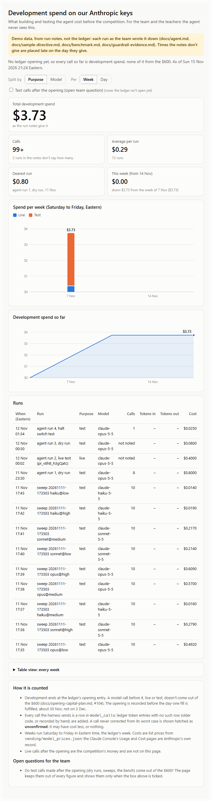

# Development spend

What building and testing the agent has cost on our Anthropic keys, week by week, until the
competition starts. **It is for the team and the teachers, not the agent.** No agent tool reads it,
and nothing in the agent's brief mentions it.

```
python -m vending.dev_spend                          # one row a week, Saturday to Friday, Eastern
python -m vending.dev_spend --daily                  # one row a day
python -m vending.dev_spend --json                   # the same, for a page or a script
python -m vending.dev_spend --html dev-spend.html    # one page with the data inside it, no server
python -m vending.dev_spend --demo --html demo.html  # from the team's run notes, no database
```

It reads the database `DATABASE_URL` points at, in a read-only session. The page is one HTML file
with its data inside it. It opens from disk, fetches nothing and uses no libraries, so you can
email it or attach it to a report.



*The demo data: the runs the team wrote down on 11 and 12 Nov, not the ledger. The page says so in
a banner. [`dev-spend/demo.html`](dev-spend/demo.html) is that page.*

## What counts

**Development ends at the ledger's opening entry** (`python -m vending.ledger open`). A model call
before it, live or test, is development spend and doesn't come out of the $600
([opening capital plan](opening-capital-plan.md), #104). The opening is recorded before the
day-one fill is fulfilled, about 30 Nov, not on 3 Dec
([David's answers, 12 Nov](planning/2026-11-12-david-answers.md)). Until it is recorded, every call
so far is development spend. The charts stop at the opening and mark it: "Ledger opened,
competition money starts".

| Source | What it adds |
|---|---|
| `model_calls` | Every request the harness has sent, live or test. A corrected (`ok`) row counts at what the API billed. |
| `ledger_entries` | `tokens` entries with no `model_calls` row: written by older code, or by a person with `python -m vending.ledger tokens`. The model comes from the detail ("model: N tokens in, M out"). The purpose and the run's label come from the reference. |

- **Unconfirmed** spend is a call that was never corrected from its worst case: a `pending` or
  `error` row, an entry whose reference still says "pending" or "estimate: ...", or one the harness
  "kept at worst case". It may have cost less, or nothing. It is its own hatched segment, never
  part of the live, test or model splits.
- A `refused` call cost nothing and is left out.
- **A run** is one harness (`run_id`): an agent run, one sweep config, one bench. A ledger entry has
  no run id, so its run is its label (without "turn N") on one Eastern day.
- Tokens are counted only where they are known. An unconfirmed call's tokens aren't known, and
  neither are the run notes'. The tables mark what is missing.

**After the opening**, live calls are the competition's money and are not shown. Test calls after
the opening are an open question (see below). They are kept out of every development figure. The
page shows them as their own series only when you tick "Test calls after the opening".

## The page

- **Tiles:** total development spend (and how much of it is unconfirmed), calls, average per run,
  the dearest run, and this week compared with last week. After the opening, the last week is the
  last week of development.
- **Spend per week or per day**, stacked by purpose (live, test) or by model. The dearest bar has
  its total on it. Hover over a bar, or focus it with Tab, to see every segment.
- **Development spend so far:** the running total at the end of each week or day. It ends exactly
  at the opening.
- **Runs:** date, label, purpose, model, calls, tokens and cost, newest first.
- **Table view:** every week or day with each series, for reading without colour and for copying.

It follows the system's light or dark setting. A link can choose the view: `#model`, `#day` or
`#after`, joined with `&`.

## The demo data

`--demo` uses the runs written down in the repo, because no database we may read holds them yet.
The Azure test database `ai-vend-2` holds test data that will be reset.

| Run | When (Eastern) | Model | Calls | Cost | Where it's written down |
|---|---|---|---|---|---|
| First model sweep, nine configs × ten cases | 11 Nov from 17:35 | Opus, Sonnet, Haiku | 90 | $2.43 | [benchmark.md](benchmark.md), "The first run" |
| Agent run 1, dry run | 11 Nov (no time given) | `claude-opus-5-5` | 8 | $0.80 | [agent.md](agent.md) |
| Agent run 2, live test before the opening | 12 Nov 00:02 | `claude-opus-5-5` | not noted | $0.40 | [sample-directive.md](sample-directive.md) |
| Agent run 3, dry run | 12 Nov (no time given) | `claude-opus-5-5` | not noted | $0.08 | [agent.md](agent.md) |
| Agent run 4, halted by a person | 12 Nov 01:34 | `claude-opus-5-5` | 1 | $0.024956 | [guardrail-evidence.md](guardrail-evidence.md) |

That makes $3.73 in all. Each sweep config's cost is its "$/decision" times ten. Runs 1 and 3 have
no time of day in the notes, so they are placed late on the day, in the order the notes list them.
The sweep's answers were graded by Claude Code subagents, not on our key, so the grading isn't here.

## Open questions

- **Do test calls after the opening come out of the $600?** Migration 011 records Kevin's 4 Nov
  rule: development spend is outside the $600. `vending/usage.py` counts only live calls from the
  opening on as the competition's money. Neither says outright what a dry run, a sweep or a bench
  run in December is. Until the team decides, this page keeps them apart and off by default.
- **What the agent can see.** `get_account_balance` leaves pre-opening token entries out of the
  balance, but one of its notes gives their count and total ("development spend, not in the
  balance"). `get_pnl` with an explicit start before the opening counts them as token spend and
  says nothing. Only live calls reach the ledger, so this concerns live tests before the opening
  (such as agent run 2), not test runs.
