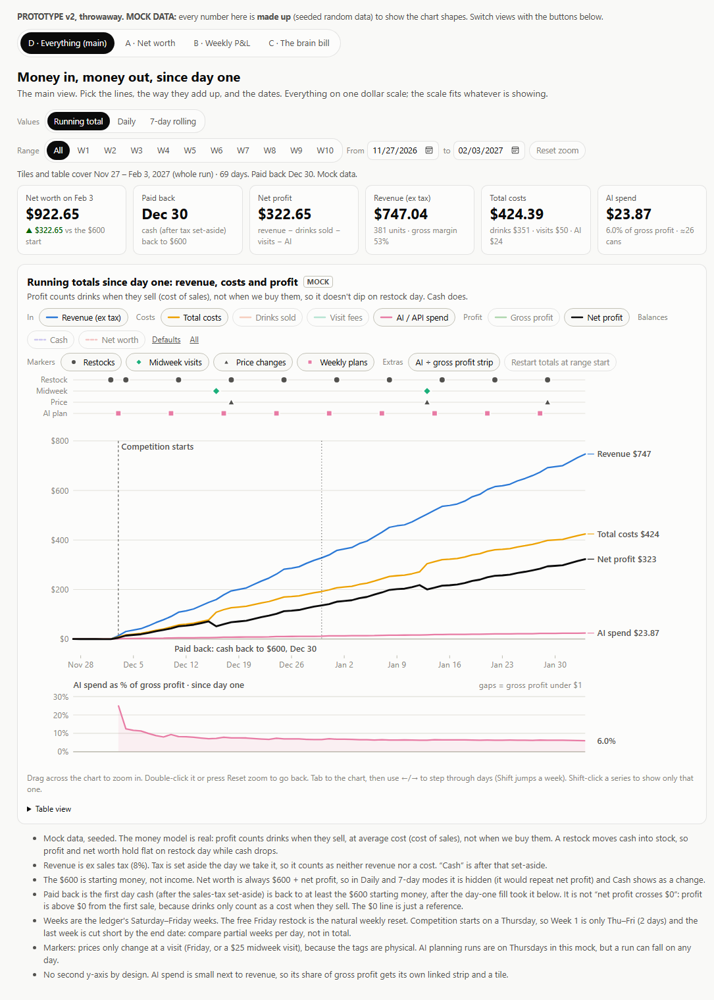
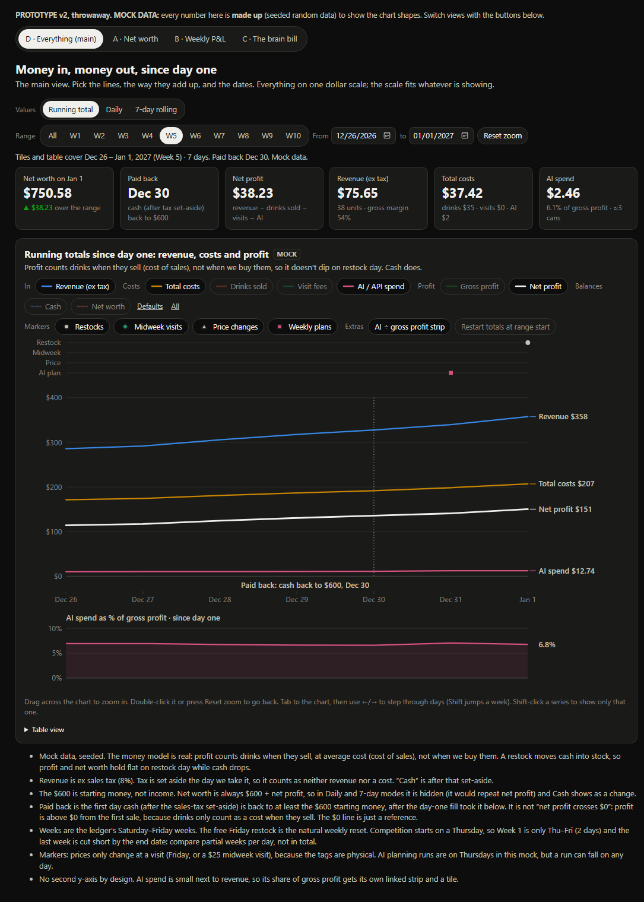
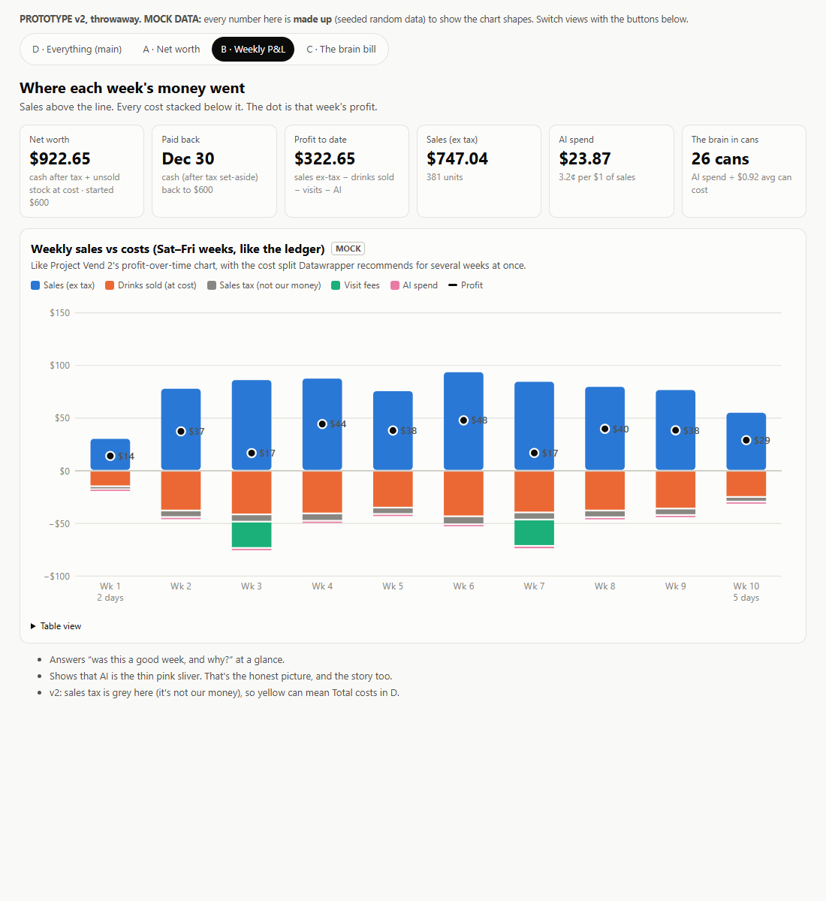
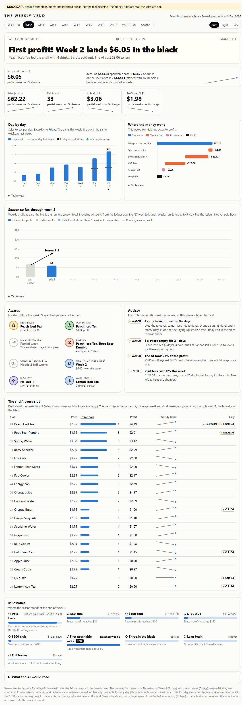
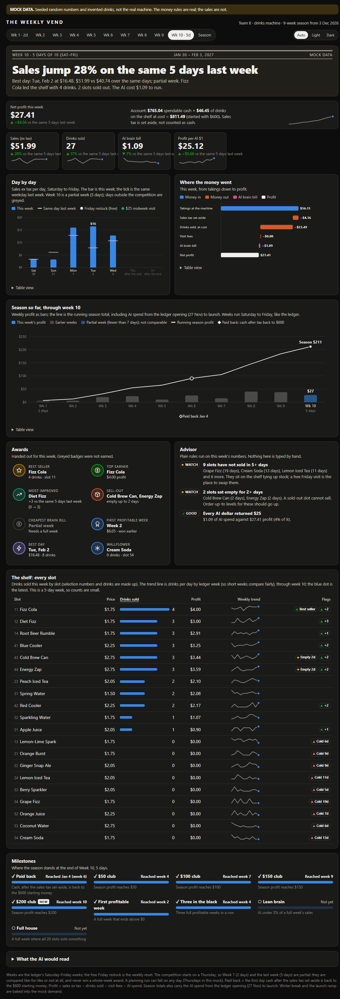

# Money chart and weekly report: ideas

Two prototypes for seeing the competition's money over time: a chart of spending, revenue and
profit with toggles, and a weekly report in the style of a business simulation game. **Every number
in them is made up** (seeded random data); the money rules are real. They are here to agree on what
the pages should show before any real data exists. They are not wired to the database.

Open the prototypes in a browser, no server needed:
[`money-chart-prototype.html`](money-chart-ideas/money-chart-prototype.html) and
[`weekly-report-prototype.html`](money-chart-ideas/weekly-report-prototype.html).

They overlap with pages we already have, so the proposal is to fold the best parts into those, not
to add new ones: the chart into the money panel (#124) and the report into the weekly P&L report
([`pnl-report.md`](pnl-report.md), #56).

## The money chart

One chart with every money line on one dollar scale. Click a line's name to hide or show it, and the
scale fits whatever is showing.

- **Lines:** revenue (ex tax), total costs, drinks sold at cost, visit fees, AI spend, gross profit,
  net profit, cash and net worth. Revenue, total costs, net profit and AI spend are on by default.
- **Values:** running total, daily, or a 7-day rolling total.
- **Range:** the whole run, one week (W1 to W10), dates, or drag across the chart to zoom.
- **Markers:** restocks, midweek visits, price changes and the AI's planning runs.
- **Paid back:** the first day cash (after the sales tax set-aside) is back to the $600 after the
  day-one fill. Net profit crossing $0 isn't marked: drinks are a cost only when they sell, so
  profit is above $0 from the first sale and the moment means nothing.
- **AI spend as a share of gross profit:** a small strip under the chart, instead of a second
  y-axis, because AI spend is tiny next to revenue.

Three smaller views sit behind it: net worth, weekly P&L, and the AI bill.

## The weekly report

A week-by-week report meant to be fun to read but built only from the numbers: every comment is a
simple rule over the data, never typed by hand.

- A headline for the week ("First profit!", "Paid back!", a sales jump or dip and its likely cause).
- Profit, sales, drinks sold, AI spend and profit per AI dollar, each against last week.
- Day by day, where the money went (takings down to profit), and the season so far.
- Awards (best seller, sell-out, cheapest AI week), advisor notes (a slot with no sales for 5 days,
  a slot empty for 2), every slot with its trend, and milestones ($50 profit, paid back).
- **What the AI would read:** the same week as a short block of numbers and flags, the shape of the
  agent's briefing (below).

## Decisions already made

- **Weeks are the ledger's Saturday to Friday weeks** (`ledger.week_of`); the free Friday restock is
  the weekly reset. The run starts on a Thursday, so Week 1 is Thu 3 and Fri 4 Dec (2 days), and
  9 weeks of competition span 10 ledger weeks. Short weeks are labelled, can't win "best week"
  awards, and are compared per day or not at all.
- **Paid back replaces break-even**, as above.
- **Development spend is never in these pages or anything the agent reads.** A model call before
  the ledger's opening is development spend and doesn't come out of the $600 (#104). It gets its own
  chart for the team and teachers, separate from these.

## What comes next

- **A daily money series** from the ledger (`vending/money_series.py`, in progress), so these pages
  read real numbers. It counts only from the ledger's opening.
- **The agent's briefing:** the same figures, worked out by code before each run and put in the
  agent's first message as a short table with alerts first, so the model doesn't spend tokens
  gathering and adding them up (in progress, `get_briefing`). The balance check and the plan
  preview stay tool calls.
- **A development spend chart:** what building and testing the agent has cost, week by week, until
  the ledger opens.

Comments on what to keep, cut or add are welcome on the PR.
