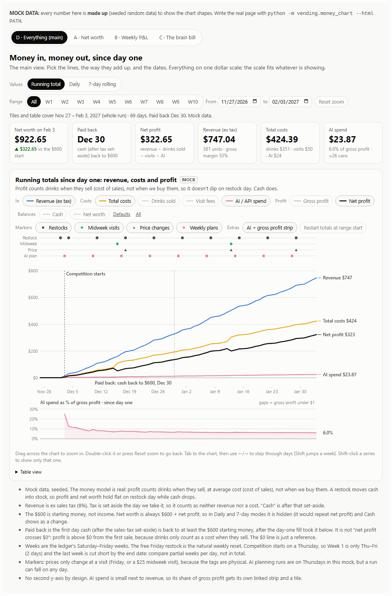

# The money chart

Competition money by day, on one page: revenue, costs, profit, cash and net worth since the
ledger's opening, with toggles. It is the main chart from the ideas in #139, now reading real
data from the money series (`vending/money_series.py`).

```
python -m vending.money_chart --html money-chart.html                  # the opening day to today
python -m vending.money_chart --html money-chart.html --start 2026-12-03 --end 2027-01-31
python -m vending.money_chart --json                                    # the data the page carries
python -m vending.money_chart --demo --html demo.html                   # made-up data, no database
```

The page carries its data inside it, so it opens from a file with no server and fetches nothing.
Until the ledger is opened there is nothing real to chart, so `--html` refuses and says how to
record the opening; `--demo` writes the page with seeded mock data, marked MOCK.
[`money-chart/demo.html`](money-chart/demo.html) is that demo.



## What it shows

- **Lines:** revenue (ex tax), total costs, drinks sold at cost, visit fees, AI spend, gross
  profit, net profit, cash and net worth. Click a line in the legend to hide or show it;
  shift-click to show only that one. The scale fits whatever is showing, so hiding revenue
  makes AI spend readable. There is one dollar axis, never two.
- **Values:** running total, each day, or a 7-day rolling total.
- **Range:** the whole run, one week (Saturday to Friday, as the ledger counts them), or any
  dates. Drag across the chart to zoom; double-click to go back.
- **Markers:** restocks, midweek visits, price changes and days with AI calls, in lanes above
  the chart. Hover for the detail.
- **AI spend as a share of gross profit,** in a strip under the chart.
- **Tiles:** net worth, the day cash was back to the starting money, net profit, revenue, total
  costs and AI spend, for the range shown.
- Other views: net worth split into cash and stock, a weekly P&L, and AI spend by day.

## Where the figures come from

Every figure is the money series', so each day adds up to `ledger.pnl` and each day's cash is
`ledger.balance` at its end. The page works out two balances from it:

- **Cash** is the ledger balance less the sales tax still owed (taken in, not yet remitted).
- **Net worth** is that cash plus the drinks on hand at what we paid for them. A restock moves
  money from cash into stock, so net worth holds; only profit and capital move it.

Competition money only: counting starts at the ledger's opening, so model calls before it
(development spend, #104) are in no figure. A counter reading just before the opening that later
polls show was a misread isn't used as the baseline; the balance uses the same rule
(`ledger.opening_rises`).

**Unknown stays unknown.** A missing cost makes the affected profit and cost totals unknown.
Lines leave a gap on any day a value is unknown (cash and net worth too), and a known day between
unknown ones shows as a dot. Rolling totals and selected ranges recover when their own days have
complete costs. In the weekly view a week with an unknown cost gets a dashed "?" box, the label
"incomplete" and no profit dot. Units sold across a product swap the counters can't split have no
exact cost, so their day's gross profit and net are unknown too. The series carries an estimate
for them apart (`units_estimated`, `estimated_cost_of_sales`), and the day's note in the tooltip
states it as an estimate. It is never drawn into a cost or profit line (#172 item 5). The stock
those sales took is `unattributed_stock`, a reconciliation line in no cost or profit, which the
day's note also states, so each day's cash and stock at cost still add up. One timing exception:
a unit the counters split to the old product at a swap leaves stock at the swap but is booked to
the poll that measured it. When that poll falls on a later day, the earlier day's cash and stock
are off by that unit's cost and the later day makes it up; weekly and whole-run figures balance
unless a week ends between the two.

**Exact money.** The page sums exact cents before it rounds values for display, and every value
label keeps its cents; only axis ticks are rounded.

**Exports that start late.** A profit tile covers the exported period, which can start after the
ledger opening or end during an unfinished day. When it starts after the opening, the balance
before its first day isn't in the data, so a daily, rolling or restarted change in cash or net
worth that reaches back past it is unknown, not a change from the opening capital. Paid back is
always against the ledger's own opening capital; if cash is already there on the first exported
day, the page says "paid back by" that day.

**Weekly view.** The bars are the terms of profit: sales (and any positive adjustment) above the
line; drinks sold, shrinkage, visit fees, AI and any negative adjustment below. The profit dot is
where they net out. Sales tax is set aside, so it is in the tooltip and table but not the bars.

**Phones.** The charts are drawn at the screen's width, so text stays readable at 390 px; margins,
tick counts and end labels (value only) shrink to fit. The range can be a single day.

## Not yet

- It isn't on the dashboard yet. Next: serve it next to the money panel (#124).
