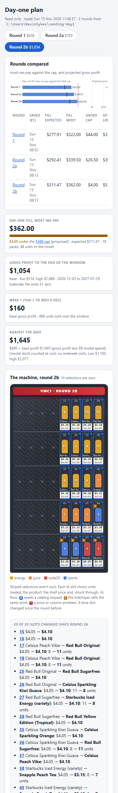

# The day-one planning page

One page that shows the agent's day-one plan round by round:
- what goes in each of our 20 slots, and how each round changed from the one before
- what the fill costs against the proposed $366 cap
- what each slot is projected to sell and earn
- which catalog requests the plan needs, and how far each has got
- where the Interloper (#116) sells the same drink

```
python -m vending.plan_page --rounds C:\Users\KevinSykes\vending-day1          # http://127.0.0.1:8768
python -m vending.plan_page --rounds DIR --no-db                               # no catalog-request status
python -m vending.plan_page --rounds DIR --write plan.html                      # one file, no server
```

The page runs on your own machine only. The round files live outside the repo, so the Container App can't see them. Once the `sim_rounds` table exists, the page can move to `/dashboard/plan` and read from that table. Until then, the team sees it through the claude.ai copy listed in [`artifacts.md`](artifacts.md). Make that copy with `--write` and publish it again after each round.

| Whole page (seeded test data, light) | Top of the page (dark) | Phone (390 px) |
|---|---|---|
|  |  |  |

The screenshots show the real round 1, 2a and 2b files. The catalog requests come from a throwaway local database seeded with sample requests, not from the team's database.

## Where each number comes from

| On the page | Source | Computed here? |
|---|---|---|
| Product, units, shelf price, the agent's reason | `roundN/plan*.json` (`day_one`) | read |
| Floor, legal price, whether the units fit a column | the pack list in the projection, through `vending.pricing` and `vending.capacity` | **yes**, with the planner's own rules |
| Fill cost (expected and most-we-pay), packs, closet units | the same pack list: whole packs per product, leftovers to the closet. Each slot's cost is its share of its product's packs, closet included, so the slots add up to the fill | **yes**, and checked against the projection's own totals |
| Units per class day, class days of cover, sell-out date, margin, gross profit by week and to the end of the window, low/base/high | `roundN/projection*.json` | read, never computed |
| The projection's assumptions | the projection's `assumptions` block, highlighted where they differ from the round before | read |
| Catalog request status | `product_requests` and `catalog_products` in our database (read-only) | matched by the same words rule as the duplicate check |
| The Interloper's prices | `analysis/interloper/YYYY-MM-DD.json`, one file per dated observation | read |

When the page's own count disagrees with a file, it says so under **Notes**: for example a fill total, a pack count, a price, a unit count or a SKU that differs between the plan and its projection (so the forecast was made for something else). A file with an unexpected shape is refused with its name, not shown half-read.

## Rounds

A round is one plan file. If a projection file has the same suffix, it is that round's projection: `round1/plan1.json` with `round1/projection1.json`, `round2/plan2a.json` with `round2/projection2a.json`. The page ignores every other file in the folder, such as `plan1_sku.json`, the raw model answers and the briefs.

**Plan files** may use either round shape:
- Round 1: the full plan, with floats for prices.
- Round 2: `day_one` with `price_cents` and `sku`, plus `catalog_requests`.

The page reads float prices through their decimal text and refuses any that isn't a whole number of cents. It refuses a file that names any slot outside `vending.slots.SLOTS`, so it can't show a value for the other team's selections.

**Projection files** use the `vending-day1/projection/v1` schema. Money is integer cents in every `*_cents` field, and the old float fields are ignored. Projection weeks run Thursday to Wednesday from 3 Dec, but the ledger's weeks run Saturday to Friday, so the weekly chart won't line up with the P&L report.

## Rules the page keeps

- **Only our 20 slots have values.** The other 20 selections are drawn hatched with their number and nothing else (see [`integrity.md`](integrity.md)).
- **No model calls.** Everything is computed in code or read from the files.
- **No script.** The round tabs and the "Changed slots only" switch are HTML inputs styled with CSS. The server sends `Content-Security-Policy: default-src 'none'; style-src 'unsafe-inline'`.
- **Local and read-only.** The server listens on 127.0.0.1 and answers only `localhost` or `127.0.0.1`. The database session is read-only, with a statement timeout. With no database, or if it can't be reached, the page still renders, and the catalog panel says the requests weren't checked.
- **Interloper prices are display only.** The Interloper is an outside seller, not the other team. No pricing code reads these files; #102 question 14 still asks whether we may use them as an input. Prices are compared only when both sizes are known and match; otherwise the row says "different size" or "size unknown". The **I** flag on a slot uses the same match as the table.
- **The $366 cap and the $600 split are proposed (#113), not agreed.** They are reference lines only (`plan_rounds.FILL_CAP_CENTS`).
- **A request's status isn't synced back yet.** Nothing reads it from the bridge. So a drink counts as approved once it appears in our copy of the catalog. The team's list is #119.

## Not here yet

- **The money panel (#48)** on `/dashboard`: balance, spend and token spend against $600. This is next.
- **Forecast against actual** once the run starts: needs the projection stored with its `plan_hash`.
- **Reading `sim_rounds`** instead of the folder, once that table exists.
