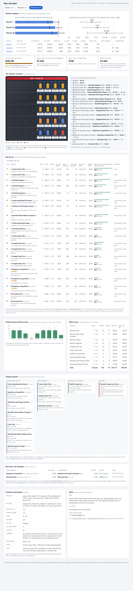
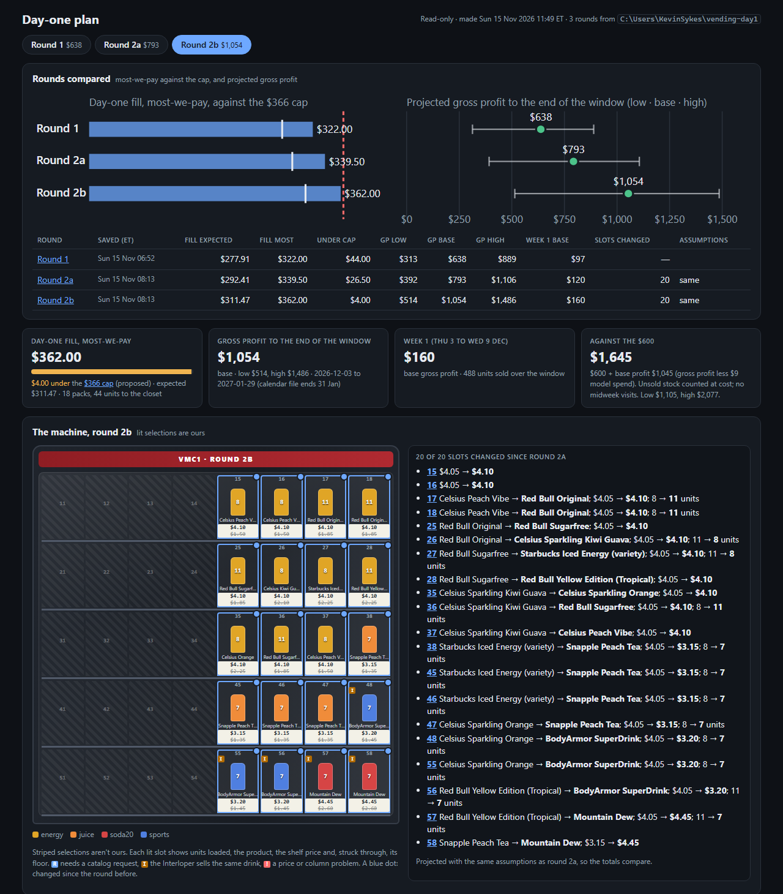

# The day-one planning page

One page that shows the agent's day-one plan round by round:
- what goes in each of our 20 slots, and how each round changed from the one before
- what the fill costs against the proposed $366 cap
- what each slot is projected to sell and earn
- which catalog requests the plan needs, and how far each has got
- where the Interloper (#116) sells the same drink

```
python -m vending.plan_page --rounds C:\Users\KevinSykes\vending-day1          # http://127.0.0.1:8768
python -m vending.plan_page --rounds DIR --no-db                               # no catalog-request status (our slots still from DATABASE_URL)
python -m vending.plan_page --rounds DIR --write plan.html                      # one file, no server
```

The planning page runs on your own machine. Use `--write` to make a copy for the team, as listed in
[`artifacts.md`](artifacts.md).

## Put a plan on the dashboard

The Container App reads the first-fill plan from `first_fill_plans`. Migration 020 creates this
table. Run these commands from a laptop with the round files and the database writer login.

```
python -m vending.plan_store load DIR --round 3 --by NAME
python -m vending.plan_store list
python -m vending.plan_store pick ID --by NAME
```

`DIR` can be the folder with the plan file or the folder with the round folders. The loader checks
the plan and projection against the current server assignment. It saves those files' JSON and
the assignment. Load and pick each record a write in `action_log`.

Before the slot lock, **The plan** on the dashboard shows the picked plan. With no pick, it
shows the latest plan and labels it "latest, not picked". After a redraw, load and pick a plan
for the new assignment. At the lock, the dashboard switches to the agent's Friday plan.

| Whole page (seeded test data, light) | Top of the page (dark) | Phone (390 px) |
|---|---|---|
|  |  |  |

The screenshots show the real round 1, 2a and 2b files. The catalog requests come from a throwaway local database seeded with sample requests, not from the team's database.

## Send the picked plan as the day-one fill

The fill's purchase request is due by 23:59 ET on Sun 29 Nov. Staff buy and stock it on Mon 30 Nov.
`python -m vending.fill` turns the picked plan into that request (#214). It uses the agent's own
planner, hash and submit, so the request is recorded the same way as the agent's.

```
python -m vending.fill                                    # preview only; sends nothing
python -m vending.fill --submit --hash HASH --by NAME     # send it
python -m vending.fill --submit --hash HASH --late --by NAME   # send it after the deadline anyway
python -m vending.fill --submit --hash HASH --accept-deviations --by NAME   # send packs that differ from the pick
```

1. Run the preview. It shows each line (slot, product, units, store, packs, unit cost, sale price),
   the total cost against spendable cash, and the plan hash.
2. Read the warnings. A line whose store cutoff for Mon 30 Nov has passed will likely be stocked at
   the next scheduled visit. For Mon 30 Nov, the Amazon cutoff is Sat 28 Nov 23:59 and the in-store
   cutoff is Sun 29 Nov 23:59.
3. Read "Differs from the pick", if the preview shows it. The command buys from the sourcing table's
   checked rows, so a product can come out in another pack size, another number of packs or units, or
   a higher most-we-pay cost than the pick. Each product that differs is listed, with what the pick
   buys and what the request buys. The send refuses with `pick_deviation` unless you add
   `--accept-deviations`, and `action_log` records the flag and the list. Or load and pick a revised plan.
4. Send it with the hash from step 1. If anything changed since the preview (plan, price, pack or
   balance), the hash no longer matches, and the command refuses with `plan_changed`. Run the
   preview again. The hash also covers the picked plan's ID and our slots (the server's assignment),
   so a hash from another plan or assignment never sends this one.

While the send runs, it holds the pick, the slot assignment, the sourcing table, our catalog copy and
the ledger. A `plan_store pick`, a new slot assignment, a `sourcing set` or a change to the ledger's
opening waits until the send is over. So the checked prices and the opening that the checks read are
the ones the planner reads. The checks also run again on the exact rows and opening the planner was
given. Right before the POST, the command reads the pick and our slots again and refuses with
`pick_changed` if either changed.

The deadline is checked right before the POST too, once the attempt is saved in
`purchase_submissions`. It comes from the Key dates panel (`vending.key_dates.FILL_REQUEST`). From
00:00 ET Mon 30 Nov the command refuses with `fill_deadline`, unless you add `--late`. A send that
crosses midnight while it runs is stopped there, and its attempt is marked never filed (nothing was
sent). A late request may be denied, but it may not be, so a person can still choose to send it. The
preview warns once the deadline has passed, and `action_log` records `late`.

The request buys what the plan buys. The plan adds up each product's units across its slots and rounds
that total up to whole packs: ten slots of 7 Coca-Cola is six 12-packs, not ten. So the request has:

- one purchase line per product, on its first slot, with the packs for all its slots;
- a back-stock line for each of the product's other slots, which loads that slot's units from those packs;
- a note that names how many units go in each slot. The bridge's purchase line has no load target, so
  without it the worker would fill the first slot with whatever fits. The note groups the slots by
  where their units come from: "From slot A's purchase: A=7, B=7." for a purchase and the slots it
  feeds, "Own purchase:" for a purchase line that feeds no other slot, and "From closet stock:" for a
  back-stock line that loads units already in the closet. For 20 slots it stays under the bridge's 500
  characters.

The bridge spec doesn't say if a line may load units that another line of the same request bought. We
asked David on 19 Oct, with no answer yet. Confirm it with him before the real send. The note says it
plainly. The agent's own plans still buy per slot.

The command sends the products at the sourcing table's checked prices, never the plan's estimates.
It refuses, with every reason and nothing sent, when:

- the plan was picked for another slot assignment than our slots (the server's assignment) now
  (`plan_assignment`);
- a product has no sourcing row, store or checked price (`no_checked_price`, #202);
- a product's alternate has no checked price (`no_checked_price`). The request sends the alternate
  too, so the command refuses rather than drop it. Check its price or remove it
  (`python -m vending.sourcing remove SKU --alternate --by NAME`);
- the ledger has no opening, an opening dated after now, or only the test opening from before the fall
  cut (`test_opening`, #215);
- a request was sent since the opening, or by this command at any time, and was not rejected by the
  bridge (`fill_already_sent`). The command's own attempts carry `purpose = 'fill'` in
  `purchase_submissions`, saved before the POST and kept when the attempt is settled or resolved by
  hand, so an interruption before `action_log` is written can't hide a sent fill;
- the sourcing table or the opening changed during the send (`inputs_changed`). The locks above
  should stop this, so it is a second check;
- the agent's own submit refuses: over spendable cash, a pending request, an unsettled submission,
  the halt switch, and the rest in [`tool-contracts.md`](tool-contracts.md).

A sent request goes into `purchase_requests`, where the hourly `python -m vending.sync_requests`
reads its status and receipts. `action_log` records who sent it and the plan's ID (tool `fill.submit`).

## Where each number comes from

| On the page | Source | Computed here? |
|---|---|---|
| Product, units, shelf price, the agent's reason | `roundN/plan*.json` (`day_one`) | read |
| Floor, legal price, whether the units fit a column | the pack list in the projection, through `vending.pricing` and `vending.capacity` | **yes**, with the planner's own rules |
| Fill cost (expected and most-we-pay), packs, closet units | the same pack list: whole packs per product, leftovers to the closet. Each slot's cost is its share of its product's packs, closet included, so the slots add up to the fill | **yes**, and checked against the projection's own totals |
| Units per class day, class days of cover, sell-out date, margin, gross profit by week and to the end of the window, low/base/high | `roundN/projection*.json` | read, never computed |
| The projection's assumptions | the projection's `assumptions` block, highlighted where they differ from the round before | read |
| Catalog request status | `product_requests` and `catalog_products` in our database (read-only) | matched by the same words rule as the duplicate check |
| The Interloper's prices | `analysis/interloper/YYYY-MM-DD.json`, one file per dated observation | read |

When the page's own count disagrees with a file, it says so under **Notes**: for example a fill total, a pack count, a price, a unit count or a SKU that differs between the plan and its projection (so the forecast was made for something else). A file with an unexpected shape is refused with its name, not shown half-read.

## Rounds

A round is one plan file. Pair files by their round ID, for example `plan2a.json` with
`projection2a.json` or `r4.plan.json` with `projection4.json`. The loader ignores other files
such as `plan1_sku.json`, raw model answers and briefs.

**Plan files** may use either round shape:
- Round 1: the full plan, with floats for prices.
- Round 2: `day_one` with `price_cents` and `sku`, plus `catalog_requests`.

The page reads float prices through their decimal text and refuses any that isn't a whole number of cents. A round that names any slot outside our slots (the inventory server's assignment, read from the database by `vending.slots.our_slots`) isn't shown slot by slot, so the page can't show a value for any other selection. It is set aside and listed under **Rounds compared** with its projection's own fill and gross profit, read as written. Rounds made before the 20 Nov redraw end up there. Any other problem with a file still stops the page. With nothing recorded, or no database, the page refuses and says to run `python -m vending.slots record`.

**Projection files** use the `vending-day1/projection/v1` schema. Money is integer cents in every `*_cents` field, and the old float fields are ignored. Projection weeks run Thursday to Wednesday from 3 Dec, but the ledger's weeks run Saturday to Friday, so the weekly chart won't line up with the P&L report.

## Rules the page keeps

- **Only our assigned slots have values.** The other 20 selections are drawn hatched with their number only. That is because the plan places products in our 20 slots, not because the rest belong to anyone yet: the inventory server changed the split once, on 20 Nov, and it is final for the quarter (David, 20 Nov). `python -m vending.slots record` stored the new split, and the plan was placed again in the new slots as a new round; rounds made before it are set aside. Fall sales from all 40 selections, from polls before the fall cut, may be used for planning (Kevin's decision, 15 Nov; `docs/integrity.md`).
- **No model calls.** Everything is computed in code or read from the files.
- **No script.** The round tabs and the "Changed slots only" switch are HTML inputs styled with CSS. The server sends `Content-Security-Policy: default-src 'none'; style-src 'unsafe-inline'`.
- **Local and read-only.** The server listens on 127.0.0.1 and answers only `localhost` or `127.0.0.1`. The database session is read-only, with a statement timeout. With no database, or if it can't be reached, the page refuses, as it does with nothing recorded, because it can't tell which selections are ours. `--no-db` skips only the catalog check, and the catalog panel then says the requests weren't checked.
- **Interloper prices are display only.** The Interloper is an outside seller, not the other team. No pricing code reads these files, and none may: David said on 17 Nov that the Interloper's prices are not a pricing input. Prices are compared only when both sizes are known and match; otherwise the row says "different size" or "size unknown". The **I** flag on a slot uses the same match as the table.
- **The $366 cap and the $600 split are proposed (#113), not agreed.** They are reference lines only (`plan_rounds.FILL_CAP_CENTS`).
- **A request's status isn't synced back yet.** Nothing reads it from the bridge. So a drink counts as approved once it appears in our copy of the catalog. The team's list is #119.

## Not here yet

- **The money panel (#48)** on `/dashboard`: balance, spend and token spend against $600. This is next.
- **Forecast against actual** once the run starts: needs the projection stored with its `plan_hash`.
