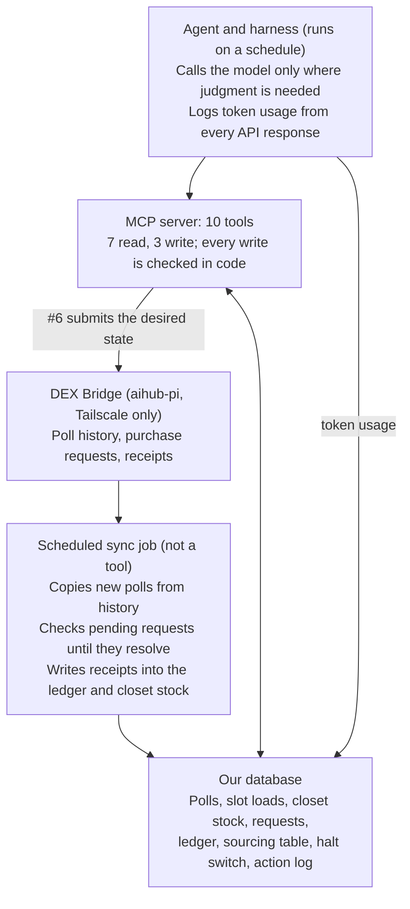

# Vending Agent Tool List

Snapshot of the team's shared Claude doc, taken 19 Oct 2026 (doc revision 56). **The live copy is the doc:**
<https://claude.ai/code/artifact/82ae22ab-53a2-48c0-b4d5-c636efcc877d>. Edit and comment
there; this file is a point-in-time copy so the plan sits next to the code.

**Changelog, 19 Oct 2026:** write side redesigned around David's desired-state purchase request: revised tools table, plus new sections on the desired state, the restock planner and the pricing gate. The 15 Oct version is in this file's Git history and in the doc's history.

**Update, 29 Oct 2026 (repo only, not yet in the live doc):** David has shipped the new purchase-request schema and the product-request routes. The sections below still describe the 19 Oct plan; read "What the live API answered on 29 Oct" first. Field details are in [`../dex-bridge.md`](../dex-bridge.md).

## What the live API answered on 29 Oct

**Checked against `http://aihub-pi:8000/openapi.json` on 29 Oct. The bridge still reports version `0.1.0`, so the version number doesn't show changes.**

| Open question (19 Oct) | What the live API says |
| --- | --- |
| Final desired-state schema and field names | Body is `off_cycle`, `note`, `lines`. Each line is a slot with `source: "purchase"` (a `primary` and optional `alternate` choice) or `source: "back_stock"` (a `load`). The spec does not say every one of our 20 slots must be listed. |
| Is a $25 midweek visit a flag or its own route? | A flag: `off_cycle: true` on the request, for a visit on any day but Friday. The spec does not mention the fee, but the team confirmed on 29 Oct that it is still $25. |
| Store list | `Walmart`, `Costco`, `Amazon`, `BJs`, spelled exactly. Our planned codes (`WALMART`, `BJS` and so on) must map to these. |
| Can the alternate be a different product, with its own sale price? | The schema allows it: the alternate has its own `sku` and `sale_price`. Only `alternate_same_as_primary` is refused. |
| Catalog-request routes (#11) | Shipped: `POST /api/v1/product-requests` (`name`, `size`, optional `line`, `flavor`, `note`) and `GET /api/v1/product-requests/{id}` (`pending`, `rejected`, or `approved` with the SKU). |
| Spoilage field | Shipped: `units_lost` and `loss_note` on each receipt, plus `later_losses`, which can grow after a request is fulfilled. |
| Catalog shape | Single items: `sku`, `name`, `line`, `flavor`, `size`. Pack size goes on the purchase line as `units_per_pack`. Three products on 29 Oct, one a test entry. |

**Field names that differ from our 19 Oct draft:** `units_per_pack` (we wrote `pack_size`), `max_price_per_pack` (`max_pack_price`), `url` (`link`), `off_cycle` (`visit: "midweek"`).

**Limits the planner and pricing gate must respect:** `sale_price` at most $10.00 in 0.05 steps, so our ceiling must be $10.00 or lower; `packs` 1-20; `units_per_pack` 1-60; back-stock `units` 1-200; `max_price_per_pack` up to $200; `note` up to 500 characters.

**Still not in the API:**

- A price change without a load. Every line loads at least one pack or unit, so `set_price` (#8) is still blocked.
- Leaving a slot empty.
- A route that lists our requests. We still save every ID.
- How many requests may be open before `429 too_many_open_requests`.
- Whether one line can load units bought or pulled by another line in the same request.
- Whether the catalog is shared with group A.

## Purpose

The group-b vending agent should get **10 MCP tools**: 7 that read and 3 that write. Every write is checked in code before it runs. This is the working list for the team. It reconciles the 21 September build plan, the bridge's live API spec (`http://aihub-pi:8000/docs`, version `0.1.0`), the whiteboard from the 8 October team meeting, and David's answers of 19 October, which outrank the spec.

Edit it inline or leave comments. Questions we still need the instructors to answer are collected at the end.

## What the DEX Bridge API gives us

The bridge covers reading the machine and restocking our slots. **It has no route for price changes, midweek visits or catalog requests.** Every route except `/health` needs the `X-API-Key` header, and the bridge is reachable only over Tailscale.

| Route | What it does |
| --- | --- |
| `GET /health` | Checks the bridge is up |
| `POST /api/v1/poll` | Reads the machine live (about 9 seconds) |
| `GET /api/v1/history?start=&end=` | Lists stored polls: every poll from anyone, back to 28 Aug, plus an hourly poll by David |
| `GET /api/v1/history/{session_id}/raw` | Returns one stored poll as raw EVA-DTS text |
| `GET /api/v1/products` | Lists orderable products: `sku`, `name`, `pack_size`. **No prices.** |
| `GET /api/v1/slots` | Lists our 20 slots on `vmc1`: columns 5-8 of every row (15-18, 25-28, 35-38, 45-48, 55-58) |
| `POST /api/v1/purchase-requests` | Submits a restock request. Each line fills one slot. |
| `GET /api/v1/purchase-requests/{id}` | Shows `pending`, `rejected` (with a `decision_note`), or the full receipts |

What matters for the tools:

- **A purchase line is `slot` + `sku` + `packs` (1-20), with an optional alternate.** There is no sale price and no product link. A back-stock line is `slot` + `sku` + `units` (1-200) taken from the closet.
- **`change_product` must be `true` exactly when the product differs from what the slot holds now.** A wrong value in either direction is refused.
- **The bridge does not check back-stock lines.** Tracking what's in the closet is our job.
- **A request shows nothing until every line is done.** Then each line gets a receipt: `outcome`, `total_paid` (exact), `unit_cost_paid`, `units_loaded`, `units_to_back_stock`, `units_from_back_stock`, `units_pulled`, `pulled_sku`.
- **There is no route that lists our requests,** so we save every request ID ourselves. Submitting too often returns `429`.
- **The machine never reports stock on hand** (`PA1-08` is empty). Stock = units loaded (from receipts) − units sold (from polls).
- **The catalog was still empty on 8 Oct** (`{"products":[]}`), so nothing can be ordered yet.

## Proposed tools

Ten tools: seven read data and three change something (#9 is folded into #6). **Every check on a write tool runs in code and in the same statement as the write,** so the model can't get around it. None of the three write tools can be built against the live spec yet: David is reshaping the purchase request and adding the price and catalog routes. Items still waiting on him are flagged below and listed under the open questions.

| # | Tool | R/W | What it returns or does | Checks before it runs | Backed by |
| --- | --- | --- | --- | --- | --- |
| 1 | `get_machine_state` | R | For each of our slots: product, current price (`PA1-02`), units sold since the last load, stock on hand (loaded − sold), days since loaded, units per day, days of stock left. Closet units and their value at cost for each product. Rival prices while they are visible (optional field). | — | History sync + receipts |
| 2 | `get_sales_history` | R | Units and ex-tax revenue per slot over a time window | — | History sync |
| 3 | `get_catalog` | R | Approved products as **single items** (for example Coca-Cola, default flavor, 20 oz): no pack sizes, no prices. For each: our last actual unit cost from receipts (`null` if never bought), our sourcing rows (store, Amazon link, pack size, last seen pack price), and any pending catalog request. Searchable. | — | `/products` + receipts + our sourcing table |
| 4 | `get_account_balance` | R | Balance from the ledger: $600 start, plus sales revenue, minus receipts, $25 visit fees and token spend. Also the sales tax set aside (weekly takings × 0.08 ÷ 1.08, rounded arithmetically) and the spendable balance after it. | — | Our ledger |
| 5 | `preview_desired_state` | R | **Replaces `preview_purchase_request`.** Runs the restock planner on a desired state without submitting: the request lines, the worker's directive, cost at expected and at max prices, the floor for each slot, and every refusal at once | Same as #6 | Restock planner (our code) |
| 6 | `submit_desired_state` | W | **Replaces `submit_purchase_request`.** Same input as #5. Re-runs the planner on current data, submits the lines it produces, and saves the request ID with the plan. Covers restocks, product moves, pulls and price changes at a visit. `visit: "midweek"` also asks for a $25 visit. | Not halted; before the cutoff for each store; no request pending; all 20 slots listed once; products active in the catalog; stock covers every move that doesn't buy; balance covers the **max** cost (+ $25 if midweek); every sale price passes the pricing gate | `POST /purchase-requests`, **new schema not published yet** |
| 7 | `get_purchase_requests` | R | Our requests with status, `decision_note`, the plan we sent, and per-line receipts: actual unit price, units loaded versus sent to the closet, spoilage (planned) | — | Our database, filled by the sync job |
| 8 | `set_price` | W | **Only if DEX price changes work.** Changes one slot's price remotely between visits, at no cost. If they don't work, this tool is dropped and prices change only through #6. | Not halted; at most one change per slot per day (to confirm); passes the pricing gate, using the actual cost of the stock on hand | **No route yet; waits on the Cantaloupe check** |
| 9 | `request_service_visit` | — | **Folded into #6** as `visit: "midweek"`, so a $25 visit always carries a full desired state | — | — |
| 10 | `get_pnl` | R | Ex-tax revenue, cost of goods (actual cost from receipts, spread over the units left after spoilage), visit fees, token spend, sales tax set aside, and inventory at cost (machine + closet) | — | Our ledger |
| 11 | `request_catalog_product` | W | Asks the instructors to add a single-item product (brand, flavor, size; no pack). The sync job checks it until it is approved, with the new product code, or denied. | Not halted; a drink; no alcohol or THC; not already in the catalog or already requested | Catalog-request routes (coming: submit and status) |

`check_books` waits until the instructors' balance-check endpoint exists. It would compare our figures with theirs and report a match or the difference.

## What changed on 19 October

**The purchase request becomes one desired state for all 20 of our slots, so restocks, product moves and visit-time price changes all go through one tool.** The model decides what each slot should hold and charge; code works out the lines, the costs and the checks.

| Old tool | Decision | Why |
| --- | --- | --- |
| `submit_purchase_request` | Becomes `submit_desired_state` (#6) | David's request describes the machine after the restock, not a list of lines. The planner writes the lines. |
| `preview_purchase_request` | Becomes `preview_desired_state` (#5): same planner, nothing submitted | The agent sees every refusal before it writes anything. A bad plan costs one tool call, not a rejected request. |
| `set_price` | Visit-time price changes move into the desired state. The tool survives only for remote DEX changes between visits (#8). | Each purchase line carries the sale price. Remote changes depend on the Cantaloupe reader picking up prices without a power cycle. |
| `request_service_visit` | Folded into #6 as `visit: "midweek"` | A $25 visit always carries a full desired state, so it can't be spent on a single change by accident. A midweek plan that changes nothing is refused. |
| `request_catalog_product` | Kept (#11), reshaped for single-item products | Submit and status routes are coming. Pack size moves to the purchase line. |

**Waiting on David:** the new purchase-request schema, whether a midweek visit is a flag on the request or its own route, and the slot price-change route.

## The desired-state purchase request

**For each of our 20 slots, the agent states the product, sale price and fill level it wants after the next restock. Code turns that into actions.** The agent never writes "pull" or "reposition" itself; those come from comparing the target with the current state. This is also the brief's restock and pricing directive.

What the agent passes to #5 and #6 (field names are ours until David publishes his schema):

```json
{
  "visit": "scheduled",
  "slots": [
    {"slot": "15", "product": "MTDEW-20OZ", "sale_price": "2.50", "fill_to": 10},
    {"slot": "16", "keep": true},
    {"slot": "17", "product": "PICKLE-POTION-12OZ", "sale_price": "3.00", "fill_to": 6}
  ],
  "sourcing": [
    {"product": "MTDEW-20OZ",
     "primary":   {"store": "BJS", "pack_size": 24, "max_pack_price": "12.00"},
     "alternate": {"store": "AMAZON", "link": "https://www.amazon.com/dp/...", "pack_size": 12, "max_pack_price": "7.50"},
     "extra_units_to_closet": 0}
  ]
}
```

| Field | Meaning | Rules |
| --- | --- | --- |
| `visit` | `scheduled` (Friday, free) or `midweek` ($25) | `midweek` waits on David's visit route |
| `slots[]` | One entry per slot | All 20, each once |
| `keep: true` | No change: same product, same price, nothing loaded | David's "no change to this slot" |
| `product` | Catalog code for a single item | Active in the catalog |
| `sale_price` | Shelf price, tax included | Pricing gate: floor, ceiling, 5-cent step |
| `fill_to` | Units on the rail after the visit | At most `config.slot_capacity`; omitted means fill to capacity |
| `sourcing[]` | How to buy each product the plan is short of, one entry per product | Needed only for a shortfall. If missing, the planner uses our sourcing table, else refuses. |
| `store` | `WALMART`, `AMAZON`, `BJS`, possibly `COSTCO` | Store list waits on David |
| `link` | Product page | Required for Amazon |
| `pack_size` | Units per pack, such as 6, 12 or 24 | Positive whole number |
| `max_pack_price` | Most the worker may pay for one pack. No purchase tax: the institute is tax-exempt. | Sets the floor (see the pricing gate) |
| `alternate` | Same fields, bought if the primary isn't available at or under its max | The slot's one sale price must clear both floors |
| `extra_units_to_closet` | Units to buy beyond the plan, held in the closet | Counted in the max cost |

The planner reduces each slot to one of David's cases:

- **No change:** `keep`, or a target identical to the current product, price and fill.
- **Restock:** same product, topped up to `fill_to`, from the closet first, then from a purchase. A new price can ride along.
- **Price only:** same product, new price, nothing loaded.
- **Reposition:** the product comes from another slot whose target holds something else.
- **Switch:** a new product. The old units go to the closet; the new ones come from the closet, another slot or a purchase.
- **Empty:** `product: null`. **Waiting on David**; refused until he confirms a slot may be left empty.

**Waiting on David:** whether the alternate may be a different product or only the same product from another store or pack; whether it can carry its own sale price; and whether a line may load units bought or pulled by another line of the same request.

## The restock planner

**One deterministic function, `plan_restock(current, desired, config, now)`, turns a desired state into request lines or a list of refusals.** It does all the arithmetic, so the model spends no tokens on it. #5 and #6 both call it, and #6 calls it again inside the transaction that records the request. It has no side effects, so it can be tested on its own against fixtures.

**Inputs**

| Input | Source | Contents |
| --- | --- | --- |
| `current.slots` | Our database | Per slot: product, price (`PA1-02`), estimated units on hand (loaded − sold), actual unit cost of those units |
| `current.closet` | Receipts | Units and actual unit cost per product, after spoilage |
| `current.pending` | Our request records | Any request not yet resolved |
| `catalog` | `/products`, synced daily | Active products |
| `sourcing_table` | Filled in by the team | Default store, link, pack size, expected and max pack price per product |
| `balance` | Ledger | Spendable balance after the sales-tax set-aside |
| `desired` | The agent | The request in the previous section |
| `config` | `config` table | Cutoff per store, slot capacity, price ceiling, tax rate (8%), midweek fee ($25), halt flag |
| `now` | Clock | Compared with the cutoff |

**Steps**

1. Check the shape: halt off, all 20 slots once, known products and stores, Amazon links, positive pack sizes, 5-cent prices.
2. Classify each slot (no change, restock, price only, reposition, switch) and compute units needed: `fill_to` minus the units staying in the slot.
3. Build supply per product: closet units, plus units freed from slots that switch away from it.
4. Allocate supply to need: slot-to-slot moves first, then the closet, then purchases. Leftover units go to the closet.
5. Size each purchase: packs = shortfall ÷ pack size, rounded up, for the primary and separately for the alternate. Add `extra_units_to_closet`.
6. Cost it: expected = packs × expected pack price; max = packs × the higher of the two max pack prices; add $25 if midweek.
7. Run the gates: cutoff, pending request, balance against the **max** cost, and the pricing gate on every slot that gets a new price or newly bought units.
8. Return the plan, or every refusal found at once, so the agent fixes them in one turn.

**Outputs**

- `lines`: one per slot in the API's shape: slot, action, product, sale price, units to load, source (`purchase`, `back_stock` or another slot), and for purchases the store, link, pack size, packs and max pack price, primary and alternate.
- `directive`: the same plan as a plain table for the worker (slot, product, price, load how many from where, what to pull), plus a shopping list grouped by store.
- `cost`: expected and max, per line and in total, and the balance left at max.
- `floors`: each slot's floor and the arithmetic behind it.
- `warnings`: risks that aren't refusals, such as an Amazon order placed after its cutoff arriving late.
- `plan_hash`: identifies the plan, so #6 won't submit the same plan twice.

**The cutoff is configurable** because it is still undecided; the only fixed point is the Friday-afternoon restock. `config.cutoff` holds a weekday and time per store. Defaults until David decides: Thursday 23:59 for in-store purchases, Wednesday 23:59 for Amazon (two-day shipping). Past the Amazon cutoff is a warning, not a refusal, since David saw no hard Amazon deadline.

**Refusals**

| Code | Refused when | What the agent does next |
| --- | --- | --- |
| `halted` | The halt switch is on | Nothing; stop |
| `past_cutoff` | Past `config.cutoff` for an in-store purchase in the plan | Switch to Amazon, or wait for next week |
| `request_pending` | Another request is unresolved | Wait for its receipts (#7) |
| `slot_list` | A slot is missing, listed twice, or not ours | List all 20 once |
| `product_unknown` | A product is not in the catalog or is inactive | Request it (#11) and wait for approval |
| `no_sourcing` | A product is short and has no sourcing, given or in the table | Add `sourcing` for it |
| `bad_sourcing` | Store not allowed, Amazon without a link, or a bad pack size | Fix the field |
| `over_capacity` | `fill_to` exceeds the slot's capacity | Lower `fill_to` |
| `insufficient_stock` | A move draws more units than exist and nothing is bought to cover it | Add sourcing or lower `fill_to` |
| `price_off_step` | A price is not a multiple of 5 cents | Pick a legal price; it is not rounded for you |
| `below_floor` | A price is under the slot's floor | Raise the price or lower the max pack price; the refusal shows the floor |
| `above_ceiling` | A price is over `config.price_ceiling` | Lower it |
| `insufficient_balance` | Max cost, plus $25 if midweek, exceeds the spendable balance | Buy less or cheaper |
| `empty_slot` | `product: null`, until David confirms empty slots | Keep or switch the slot |
| `midweek_no_op` | A midweek plan changes nothing | Don't spend the $25 |
| `swap_unconfirmed` | Two slots swap products, which needs a pull and a load in one request | Spread it over two visits, until David confirms |

Where two slots need the same product, the planner buys once and loads both. Until David confirms a line can load units bought on another line, it buys for each slot separately instead.

## The pricing gate

**A sale price must still make money if the worker pays the max: floor = max buy price per unit × 1.08, rounded up to the next 5 cents.** The worker won't come back for a new price after buying, so the floor can't wait for the receipt. This replaces the 15 Oct floor, which used average cost.

Shelf prices include the 8% tax, so a unit sold at price P keeps P ÷ 1.08. That covers the unit's cost only when P ≥ cost × 1.08. The weekly set-aside (takings × 0.08 ÷ 1.08) uses the same split.

```latex
\text{floor} = 5 \left\lceil \frac{1}{5} \cdot \frac{\text{max pack price in cents}}{\text{pack size}} \cdot 1.08 \right\rceil
```

| Purchase line (illustrative prices, not quotes) | Max per unit | × 1.08 | Floor |
| --- | --- | --- | --- |
| Mountain Dew, 24-pack, max $12.00 | $0.500 | $0.540 | $0.55 |
| Its alternate: 12-pack, max $7.50 | $0.625 | $0.675 | $0.70, which becomes the slot's floor |
| Coca-Cola 20 oz, 24-pack, max $34.99 | $1.458 | $1.575 | $1.60 |
| Pickle Potion, 12-pack, max $29.99 | $2.499 | $2.699 | $2.70 |
| A 6-pack, max $4.49 | $0.748 | $0.808 | $0.85 |

- **Worst case wins.** The floor uses the higher per-unit max of the primary and the alternate. If units already in the slot cost more, it uses their actual cost instead.
- **Price-only changes** use the actual cost of the stock on hand, from receipts after spoilage. Average cost or first in, first out is still a team decision.
- **Unchanged prices are checked too** whenever a slot gets newly bought units. A restock at a higher max can lift the floor above the current price; that is refused as `below_floor`.
- **Exact arithmetic:** integer cents, rounded up once at the end, never down.
- **Ceiling:** `config.price_ceiling`, still to decide (proposal: $6.00).
- **5-cent steps:** an off-step price is refused, not rounded.
- **One function** runs the gate in #5, #6 and #8.

The floor covers paying the max, not breakage. If 1 of 12 arrives damaged, the pack's cost spreads over 11 units; the margin above the floor absorbs that, and later price changes use the actual cost.

## Scheduled code, not tools

**Anything that runs the same way every time is a scheduled job, not a tool the model has to choose to call.** These jobs never cost model tokens:

- Syncing poll history from the bridge (this replaces our laptop poller)
- Checking each pending purchase request until it resolves, which is how we "receive updates" from the student worker
- Writing receipts into the ledger, slot loads and closet stock
- Logging token usage from every model response
- The halt switch: checked inside every write, and the MCP server can be switched off as a backstop

**Proposed frequencies (to be decided).** The scheduled jobs cost no tokens, so they can run often. The agent costs tokens, so it runs on a weekly rhythm and is woken in between only when a job flags something.

| Job | Proposed frequency | Why |
| --- | --- | --- |
| Sync poll history | Hourly, at 10 past the hour | David's poller reads the machine on the hour. Reading history never touches the machine. |
| Check pending purchase requests and write receipts | Hourly, only while a request is pending | Requests resolve after the Friday visit; there's nothing to check otherwise. Receipts are written as soon as one resolves. |
| Check the catalog for new products | Once a day | The catalog changes rarely. This also spots catalog requests that have been fulfilled. |
| Log token usage | After every model call | Not on a timer |
| Halt switch | Inside every write | Not on a timer |
| Run the agent (model) | Main run Thursday, ahead of the midnight cutoff; otherwise only when the sync job flags something | Flags: a slot close to running out, a machine price that doesn't match what we asked for, a rejected request. See "Decide as a team". |

Fixed rules (price bounds, our slot list, the Thursday/Friday timeline) go in the system prompt or an MCP resource, not in a tool.



The agent never talks to the bridge directly, except through `submit_desired_state` and the other write tools. Everything else it learns from our database.

## Back stock (the closet)

**Drinks in the closet count as assets, valued at what we paid for them, so pulling a slow seller costs nothing on paper.** The closet holds extra drinks for later restocks and drinks pulled from slots that weren't selling.

The bridge doesn't track the closet, so our database is the only record of it. Receipts update it:

| Receipt field | Effect on the closet |
| --- | --- |
| `units_to_back_stock` | Adds extra drinks bought that didn't fit in the slot |
| `units_pulled` + `pulled_sku` | Adds drinks taken out of a slot when it switched product |
| `units_from_back_stock` | Removes drinks loaded from the closet into a slot |

Each unit carries its `unit_cost_paid`, so the closet's value and our cost of goods both come from the same records. Moving a product from slot A to slot B takes two purchase-request lines: switch slot A (which pulls the old drink into the closet), then load slot B from the closet. Whether both can go in the same request is an open question.

## Whiteboard mapping (8 Oct meeting)

**Every idea on the board maps to a tool above or to scheduled code.** Three of them added to the list: how long items sit in the machine, comparing store prices, and asking for new products.

| Whiteboard idea | Where it lands | Notes |
| --- | --- | --- |
| Receive updates | Scheduled sync job + `get_purchase_requests` (#7) | MCP tools can't receive pushes; the job checks pending requests and records receipts |
| Get machine state: units sold vs stock on hand | `get_machine_state` (#1) | |
| How long items sit in the machine, over a set time period | #1 and #2 | Days since loaded, units per day, days of stock left; a time window on sales history |
| Get account balance, start with $600 | `get_account_balance` (#4) | |
| Get sales history | `get_sales_history` (#2) | |
| Pricing: set price and change | `submit_desired_state` (#6); `set_price` (#8) only if DEX price changes work | Prices ride on the desired state and change at the visit. Remote changes between visits only if the card reader picks them up. |
| Pricing: pull prices from stores, comparison | Our sourcing table, read through `get_catalog` (#3); how it's filled is not yet decided | Fills the "catalog has no prices" gap. Use a narrow `get_store_price(sku)` against one retailer, or a price table the team fills in. **No general web-browsing tool.** |
| Request service visit ($25): switch inventory, change pricing, restock | `submit_desired_state` (#6) with `visit: "midweek"` | A $25 visit always carries a full desired state, so the three jobs ride together |
| Keep track of token usage | Harness, not a tool | Shows up in #4 and #10 |
| Submit purchase request: preview, check, send it out | #5 then #6 | Updates arrive through #7 |
| Move product if not selling well | #6 | A slot switch pulls it to the closet |
| New product research: search catalog, request product | `get_catalog` (#3), `request_catalog_product` (#11) | |
| Get P&L | `get_pnl` (#10) | |
| Holiday drinks | Strategy, not a tool | Depends on what the catalog offers; #2 shows whether seasonal items sell |

## Open questions

**The three write tools (#6, #8, #11) can't be built until David ships the routes behind the first four questions (prices, midweek visits, catalog requests).** Tick each one off as it's answered and note the answer beside it.

**19 Oct: David answered most of these in person, and his answers outrank the current API spec.** Full notes: [`2026-10-19-david-api-qa.md`](2026-10-19-david-api-qa.md). The tool table above predates them: the purchase request is becoming a desired state for all our slots, with store, max price per pack and sale price on every line, so `submit_purchase_request`, `set_price` and `request_service_visit` have been redesigned; see "What changed on 19 October" and the sections after it. The items still waiting on David are added at the end of this list.

### Ask David

- [x] How does a price change reach the worker? A purchase request has no price field. Is the 500-character `note` the intended channel? David (19 Oct): no. Each purchase line will carry the sale price, and a slot price-change route is planned.
- [ ] Can we change a price without restocking anything? If a purchase request needs at least one line, a price-only change may have no way through. David (19 Oct): possibly free and remote through DEX, limited to about once a day, if the Cantaloupe card reader picks up price changes without a power cycle. Being verified.
- [x] How do we ask for a $25 midweek visit? David (19 Oct): no endpoint yet; there will be one.
- [x] How do we ask for a product to be added to the catalog, and how long does it take? David (19 Oct): two endpoints are coming, one to submit a product request and one to check it (pending, denied, or approved with the new product code). Quick turnaround.
- [ ] Is the catalog shared with group A, or does each team have its own? (`/products` is described as "What your team can order".)
- [x] Can a catalog request be refused, and will we be told why? David (19 Oct): yes, but rarely; they only check it's nothing outlandish. A purchase request for an unlisted or inactive product is denied with a message naming it.
- [x] Will the catalog include prices, or do we only learn the cost from the first receipt? David (19 Oct): no prices. Products become single items (for example Coca-Cola 20 oz); pack size, store and max price go on the purchase line, and the receipt gives the actual per-unit price.
- [x] Does sales revenue go back into our account, or is $600 the most we can ever spend? Answered by the project brief (section 3.3): every unit sold credits our balance.
- [x] Can one purchase request pull a drink from slot A and load it into slot B? Or do pulled drinks only reach the closet after that request finishes? David (19 Oct): yes, in principle. He wants the purchase request to become a desired state for all our slots, where a line can reposition a product. Still being designed.
- [ ] Can we pull a product and leave the slot empty? Every pull in the API happens by switching the slot to another product.
- [x] Apart from purchase-request receipts, will the worker report anything back to us (jammed slots, damaged cans, closet counts), and where? David (19 Oct): the receipt reports actual per-unit cost and units loaded versus sent to inventory; a spoilage field for damaged items is planned.
- [x] Can we ask the worker for a count of our closet stock between visits (for example through the `note`), and where would we see the answer? David (19 Oct): not needed; we track the closet ourselves, and damage comes through the spoilage field.
- [x] What is the official sales-tax method: is tax included in the shelf price (price ÷ 1.08), or 8% added on top? David (19 Oct): 8%, arithmetic rounding, prices include tax, calculated weekly on takings. He said "multiply by 1.08"; the tax inside tax-inclusive takings is takings × 0.08 ÷ 1.08. Team decision (19 Oct): set aside takings × 0.08 ÷ 1.08 each week, rounded arithmetically; revisit if David says otherwise.
- [x] When will the balance-check endpoint exist, and what tolerance does it allow (about $0.25 was mentioned)? David (19 Oct): coming. A soft check that says accurate, wildly off, or in between; it never gives exact figures.
- [x] At the end of the run, how is unsold stock in the machine and the closet counted in our score? David (19 Oct): he believes at what we paid for it; verifying.
- [ ] Does token spend during development and testing count against the $600, or only during the live run?
- [x] Is a Postgres database provided, or do we host our own? Answered 19 Oct (Graham): we host our own, in Azure, alongside the agent.
- [ ] Can our repo be public?
- [ ] Bottle deposit: who pays it, and does it count in cost of goods?
- [ ] What promotions are allowed?
- [ ] Added 19 Oct: what is the final desired-state schema? Must every slot be listed, and what are the field names?
- [ ] Added 19 Oct: can a line load units bought or pulled by another line of the same request (one purchase feeding two slots, or two slots swapping products)?
- [ ] Added 19 Oct: is the alternate only the same product from another store or pack, or can it be a different product? Can it carry its own sale price?
- [ ] Added 19 Oct: is a $25 midweek visit a flag on the purchase request, or its own route?
- [ ] Added 19 Oct: what is the ordering cutoff, and does it differ by store? David floated Friday noon for in-store buying, 21 Sep said Thursday midnight, and Amazon orders are due Wednesday for two-day shipping. Restocks are Friday afternoon.
- [ ] Added 19 Oct: is the store list Walmart, Amazon and BJ's, or Costco too?
- [ ] Added 19 Oct: can we rescind a request, for example an Amazon order that won't arrive in time? Does a late delivery wait in the closet until the next visit?
- [ ] Added 19 Oct: does Amazon shipping count against the max pack price?

Already answered on 8 Oct: the closet exists and holds pulled stock at cost, and we can ask for new catalog products.

### Decide as a team

These are ours to answer; nobody else will decide them for us.

- [ ] Price bounds: what are the actual floor and ceiling? Proposal: floor = average unit cost + tax, rounded up to the next 5 cents; ceiling = a flat cap such as $6.00. 19 Oct: the floor now uses the max buy price per unit (see the pricing gate); the ceiling is still open.
- [ ] Cost method for cost of goods and closet value: average cost per SKU (the build plan's proposal) or first in, first out?
- [x] Where do the sync job and the agent run? Decided 19 Oct: Azure, on a VM that joins the tailnet. Graham issues access once we tell him what we need.
- [ ] How often does each scheduled job run? See the proposed frequencies in "Scheduled code, not tools": history hourly, pending requests hourly while one is open, catalog daily.
- [ ] Build the MCP server in n8n or plain Python? We ruled out n8n on 20 Sep; the build plan suggests reconsidering.
- [ ] Which model does the agent use, how often does it run, and what is our weekly token budget?
- [ ] Store price comparison: a narrow `get_store_price(sku)` tool, or a price table we fill in by hand? 19 Oct: now needed for the max pack price on every purchase line (the sourcing table).
- [ ] When do we pull a slow seller? What units-per-day threshold, over how many days?
- [ ] What goes in our 20 slots first once the catalog has products? Do holiday drinks get a slot?
- [ ] Who can flip the halt switch, and how?
