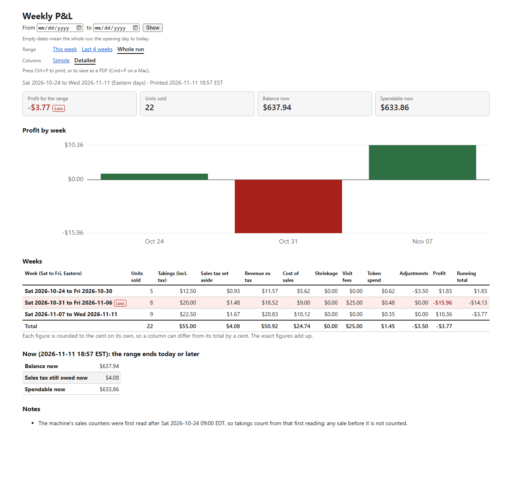
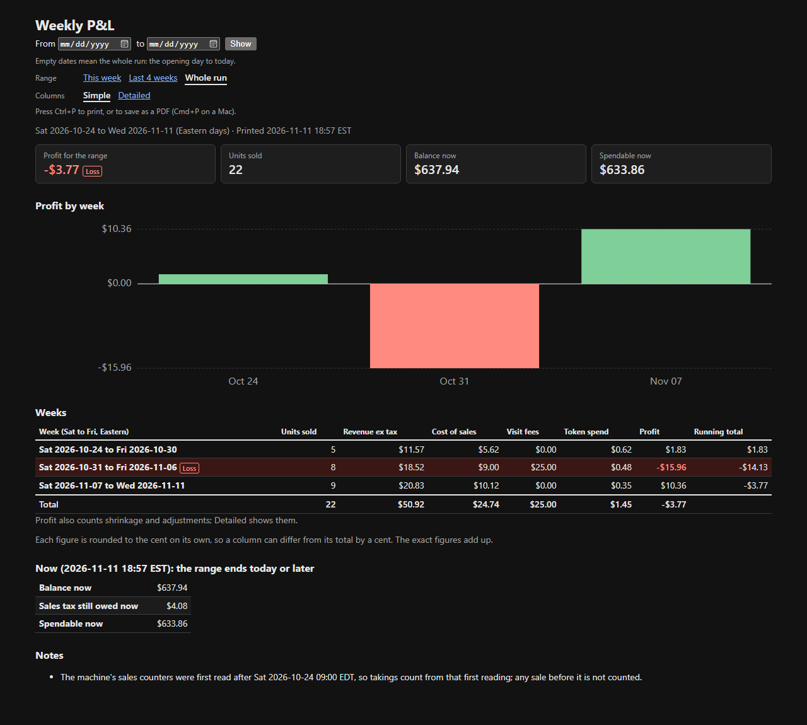
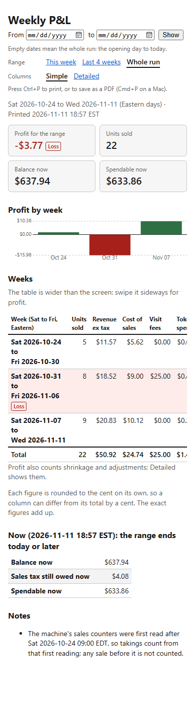

# The weekly P&L report

A page that shows our profit and loss week by week, to read or print (issue #56). Open it in a
browser and press Ctrl+P to print or save as a PDF. It reads the ledger and never writes.



```
python -m vending.pnl_report              # http://127.0.0.1:8767
python -m vending.pnl_report --port 9000
```

You need the local database with the ledger opened, as in [`mcp-server.md`](mcp-server.md):
`docker compose up -d db`, `python -m vending.db migrate`, then
`python -m vending.ledger open --amount 600.00 --by NAME`. Without an opening entry the page says
how to record one.

## What it shows

From the top: the controls (they don't print), four headline tiles, a bar chart of weekly profit,
the weeks table, the balance at the end of the range, and the notes.

**Tiles.** Profit for the range, units sold, and the balance and spendable balance at the end of
the range, labelled the same way as the balance table ("Balance now", or "Balance at the end of
Mon 2026-11-09"). When the range ends before the ledger opened, the balance tiles are left out.

**Chart.** One bar per week: profit above the zero line, a loss below it. A scale on the left gives
the top and bottom of the chart in dollars, and zero when there is room. Each bar's tooltip gives
the week and its profit. A week whose profit is unknown shows "?" instead of a bar. It is inline
SVG with a title and description for screen readers, and needs no script.

**Losing weeks.** A week whose profit shows below $0.00 has a tinted row, red profit and a **Loss** tag
next to its dates, so it shows in print and without colour too. A week whose profit is unknown is
not marked, and neither is a week short by under half a cent, which shows as $0.00.

One row per week. A week runs **Saturday to Friday, Eastern time**, the ledger's week: it turns
over after the Friday visit, and the sales tax is rounded per week (the team's 19 Oct decision).
The first and last weeks are cut to the range you chose.

**Simple** (the default) shows Units sold, Revenue ex tax, Cost of sales, Visit fees, Token
spend, Profit and Running total. **Detailed** adds Takings (incl. tax), Sales tax set aside,
Shrinkage and Adjustments. Profit is the same in both: it always counts shrinkage and
adjustments, and the simple view says so under the table.

| Column | Where it comes from |
|---|---|
| Units sold | Rises in our 20 slots' unit counters |
| Takings (incl. tax) | Rises in the sales counters, tax included |
| Sales tax set aside | Takings x 8/108, rounded half up per week |
| Revenue ex tax | Takings less the tax set aside |
| Cost of sales | The units sold, at weighted-average cost from the receipts |
| Shrinkage | The cost of units lost without a sale |
| Visit fees | Fulfilled midweek visits, $25 each unless the request stored another fee |
| Token spend | Model calls recorded in the ledger. $0 until the harness records them (#51) |
| Adjustments | Corrections recorded in the ledger |
| Profit | Revenue ex tax less cost of sales, shrinkage, visit fees and token spend, plus adjustments |
| Running total | Profit from the first week shown through this week. The competition is won on cumulative profit at week 9 |

Under the weeks are the totals for the range, then the balance, the sales tax still owed and the
spendable balance **at the end of the range**: the end of the range's last day (11:59:59 pm
Eastern), the same place the table stops, since the last week is cut to the range. The rows say
so, for example "Balance at the end of Mon 2026-11-09". When the range ends today or later, they
are as of now and say "Balance now". When the range ends before the ledger opened, the page says
there is no balance for it. The notes from the ledger come last.

**The page computes no figure of its own.** Each week comes from `ledger.pnl_by_week`, the totals
from `get_pnl`, and the balance from `get_account_balance` (which passes the range end to
`ledger.balance` as `as_of`). The exact weeks add up to the exact totals. The one sum the page
adds is the running total: the running sum of the exact weekly profit, so the last week's running
total is the range's total profit. Once a week's profit is unknown, the running total from that
week on is unknown too.
Each figure on the page is rounded on its own, so a column can differ from its total by a cent.
The page says so under the table.

**Money is exact.** Figures stay as exact fractions of a cent until they are shown, then round
half up to the cent. They show as `$1,234.56`, and a negative as `-$12.34`; no float is used.

**Unknown stays unknown.** When a unit sold has no known cost (sold before we first loaded the
slot, or from a slot we never loaded), cost of sales and profit show "unknown", with how many
units were costed. The same goes for shrinkage with no known cost. `get_pnl` gives a figure that
leaves the unknown cost out; the page doesn't show that figure as profit.

## The controls

Everything you choose is in the URL, so a link you share, or a page you print, shows the same
thing.

| Parameter | Values |
|---|---|
| `start`, `end` | Days as `YYYY-MM-DD`, Eastern, both included. Empty means the opening day / today |
| `view` | `simple` (the default) or `detailed`. Anything else is refused with a 400 |

Other parameters are ignored.

Choose a start and an end day in the form, or use a range link:

- **This week**: Saturday to Friday of the current week, Eastern time.
- **Last 4 weeks**: the current week and the three before it, Saturday to Friday.
- **Whole run**: no dates, so the opening entry to today.

The links carry the dates, so a shared "This week" link keeps showing that week after it ends.
The link that matches the page's dates is shown in bold. **Simple** and **Detailed** switch the
columns and keep the dates; the range links and the form keep the view.

**Printing.** The page allows no script (its Content-Security-Policy is `default-src 'none'`), so
there is no Print button: the page says "Press Ctrl+P to print". The printout leaves out the
controls, keeps the tiles, chart and table, prints in light colours, and fits the table to the
page width in landscape.

**Light and dark.** The page follows the browser's light or dark setting. At phone width only the
weeks table scrolls sideways; a line above it says so, and the week's dates wrap between the two
days so more columns fit.





The `before-*.png` files in `docs/pnl-report/` show the page before these controls.

## Dates the page accepts

Dates must fall between 2000-01-01 and 2099-12-31, and one page shows at most 157 weeks (three
years): 157 Saturday-to-Friday rows, where a part week at either end counts as a row. A longer
range is refused with a message.

## Safety

- It listens on 127.0.0.1 and answers only a Host of `127.0.0.1` or `localhost`.
- The session is read-only (`default_transaction_read_only`), so Postgres refuses any write.
- Each page is one repeatable-read, read-only transaction, so every figure comes from the same
  snapshot. A query that runs past 15 seconds is cancelled.
- It never migrates. Every value on the page is HTML-escaped, the links included.

## Notes

The notes from the P&L and the balance are listed once each. The ledger can give the same "no poll
at or before ..." note with one moment in UTC and in Eastern time; the page shows it once.
The "poll" notes are reworded in plain language with the time in Eastern, for example "The
machine's sales counters were first read after Sat 2026-10-24 09:00 EDT, so takings count from
that first reading; any sale before it is not counted." Other notes are shown as the ledger
gives them, starting with a capital and ending with a full stop.
