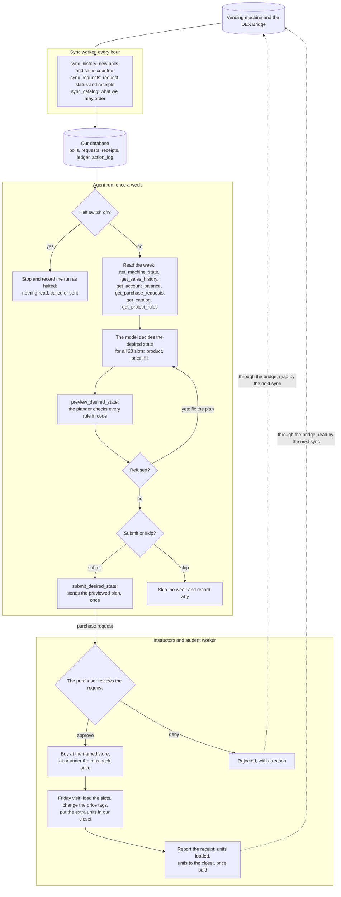
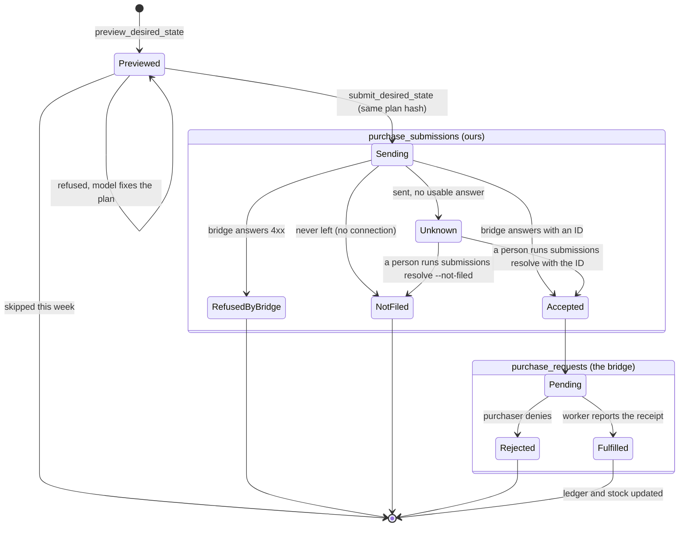

# Process map and state model

The project brief asks for a "process map or state model of the agent, exported and committed to your
repo" (Project Brief (Revised), section 5). There are two diagrams here, both drawn from the code on
`main` plus the weekly agent run in PR #58:

1. **The weekly cycle:** who does what, from the machine's sales to the next week's order.
2. **The life of one purchase request:** every state a request can be in, and what moves it on.

Each diagram is exported as an SVG in `docs/process-map/`, with its Mermaid source folded below it. **If you change a diagram, change the Mermaid source and export it again.**

## 1. The weekly cycle

Mermaid source (GitHub draws it here too)

How to read it:

- **The model is called only in the agent run**, and only to decide. Reading data, checking rules and
  doing arithmetic are plain code. The hourly sync never calls the model.
- **The planner is the gate.** Every plan, previewed or submitted, passes through the same checks:
  - the spend cap (`insufficient_balance`)
  - price bounds (`above_ceiling`, `below_floor`, `price_off_step`)
  - capacity (`over_capacity`, `unknown_capacity`)
  - the product being in the catalog (`product_unknown`)
  - store cutoffs (`past_cutoff`)
  - one open request at a time (`request_pending`, `submission_unresolved`)
  - the halt switch (`halted`)

  The model can only change its plan and try again. It can't skip a check.
- **Prices change only at a visit.** Friday's visit is free; a midweek visit is the same request
  with `off_cycle: true` and costs $25.
- **Our records change only when a receipt arrives**, not when a request is sent. A request is what
  we asked for; the receipt is what happened.
- **The halt switch** stops the run before every model request, and makes every write tool refuse.
  An instructor can turn it on without us (`docs/halt-for-instructors.md`).

## 2. The life of one purchase request

Mermaid source (GitHub draws it here too)

| State | Where it lives | What blocks while it lasts |
|---|---|---|
| `sending`, `unknown` | `purchase_submissions.status` | Every new preview and submit: `submission_unresolved`. A request that may exist must never be sent twice. |
| `pending` | `purchase_requests.status`, read hourly by `sync_requests` | Every new submit: `request_pending` |
| `fulfilled` | `purchase_requests`, plus one receipt row per line | Nothing. Stock, the closet and the ledger now include it. |
| `rejected` | `purchase_requests.status` and its `decision_note` | Nothing. The next run sees the rejection and its reason. |

## The agent run's own outcomes

Each run is one row in `agent_runs`, with every step in `agent_steps`:

| Outcome | When |
|---|---|
| `submitted` | `submit_desired_state` succeeded. The request ID is stored at once. |
| `skipped` | The model decided not to order, or it was a dry run. |
| `halted` | The switch was on at the start, or was turned on mid-run. |
| `failed` | It hit a spending cap, ran out of turns, or broke. Nothing half-sent: a submit either settled its row or left it `sending` for a person. |
